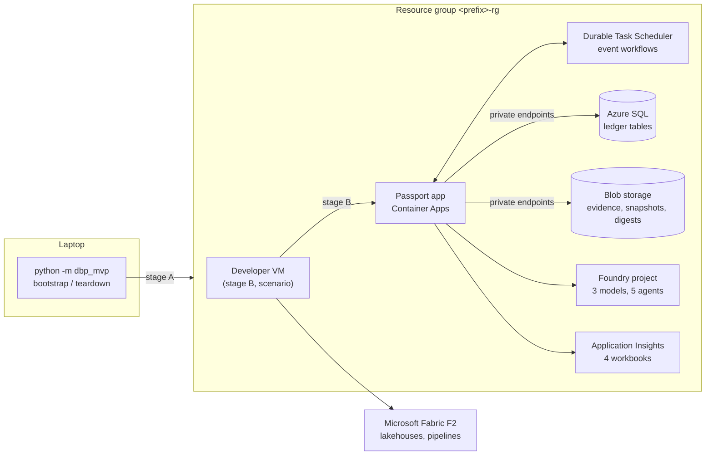

# Battery passport MVP

This synthetic scenario shows how a digital battery passport could follow a battery from sourcing through reuse or recycling. AI agents assess evidence and propose actions, application rules enforce the gates, and people make specified decisions.

The MVP includes a passport web app and a command-line tool that deploys its Azure infrastructure, runs the scenario, and tears down the environment. All data is generated, and the companies, mines, sites, batteries, and people are fictional. Emission factors, carbon figures, and costs in the scenario are illustrative.

> **Synthetic data, not a product.** The app creates MVP records, not legally valid EU battery passports, and does not contact an EU registry. This project is not legal advice or evidence of regulatory compliance. "Contoso Battery AB (publ)" is a fictional brand.

## Scenario at a glance

The four-act story follows five batteries from synthetic supplier evidence through agent checks, human review, passport publication, and lifecycle aftercare. A sourcing conflict and a cobalt compliance case hold three batteries pending human decisions. Once the checks pass, all five passports can be issued. Later, one battery enters a second life and another is recycled.

The scenario demonstrates signed-message validation, role-based views, an independent arithmetic check, and audit evidence. It does not establish real supplier due diligence, regulatory compliance, model quality, or behavior in an Azure tenant. The [scenario walkthrough](docs/scenario-walkthrough.md) explains the steps, decisions, and evidence.

The scenario data also includes original equipment manufacturer (OEM) service readings, warranty terms, and service and recall campaigns. In the default deployed setup, these records pass through Fabric ingest, Bronze, Silver, and Gold before the app imports them. An OEM's fleet role and imported pack membership determine access; the current holder is a filter, not an entitlement. Warranty flags prompt a service review, not a coverage decision. See [starting MAIN, SCALE1, and SCALE2](docs/scenario-walkthrough.md#starting-main-scale1-and-scale2).

## What it deploys

The deployment includes a virtual network, a developer VM, a passport app with Azure SQL ledger tables, a Microsoft Foundry account with five agents, and Application Insights monitoring. Microsoft Fabric is enabled by default but can be omitted. The command-line tool runs deployment in two stages: `bootstrap` on your laptop and `deploy` on the developer VM.



SQL, storage, the Foundry account and, in agent mode, Durable Task Scheduler use private endpoints. The app, container registry and monitoring endpoints are public by design. See the [architecture guide](docs/architecture.md) for component responsibilities, data flows, and trust boundaries. The [security and responsible AI threat model](docs/threat-model.md) covers MVP controls, production gaps, compliance mappings, and recommended acceptance evidence.

## AI and the EU AI Act

Before deploying, read the [AI and EU AI Act guide](docs/eu-ai-act.md), including its AI literacy briefings (Art. 4). The guide describes the intended provider and deployer roles and their duties, but its legal analysis has not been reviewed by counsel. Confirm the classification and your duties with counsel before real use.

Each agent operates within code-enforced limits (autonomy levels L2 to L4). Only people resolve sourcing concerns, decide compliance cases, approve a second life, and activate guidance. Assign named, briefed people to these roles.

The app records each accepted agent text and labels it as AI-generated at the application level. You can check copied text with `POST /provenance/verify` (Art. 50(2)).

Before the Supplier agent reads a lot's evidence, the app screens every document with Prompt Shields. A document that carries hidden instructions sends the lot to a person's review, and no model reads it. Measure detection with `python -m dbp_mvp scenario evaluation --apply --shield` ([walkthrough](docs/scenario-walkthrough.md#8-optional-evaluating-the-agent-instructions)).

## Choose your route

- **Try it without Azure:** Use the [local setup and browser preview](docs/scenario-walkthrough.md#2-on-your-pc-local-and-preview). Both use a scripted agent double, not live model behavior.
- **Deploy a new environment:** Follow the [deployment guide](docs/deployment.md) for prerequisites, settings, costs, and the laptop and VM stages. The MVP creates billable Azure resources. The guide also distinguishes resumable deployment phases from destructive data-reset and teardown operations.
- **Run an existing deployment:** Start with the [scenario walkthrough](docs/scenario-walkthrough.md#before-you-start). Run `run story` on the VM, then follow the story in the app.
- **Stop or remove the environment:** Use `vm stop` to deallocate the developer VM, or follow the [teardown guide](docs/teardown.md) to remove the deployment. Other resources can still incur charges after the VM stops.

## Costs: drivers and controls

The deployment creates billable resources in your subscription. Prices depend on the region, agreement, and date. Estimate them with the [Azure pricing calculator](https://azure.microsoft.com/pricing/calculator/) and the [Microsoft Fabric pricing page](https://azure.microsoft.com/pricing/details/microsoft-fabric/).

| Cost driver | Control in this MVP |
|---|---|
| Developer VM (`Standard_D4s_v5`), disk, and public IP | Daily auto-shutdown (`vm_auto_shutdown`); `python -m dbp_mvp vm stop` deallocates the VM. The disk and IP are billed while the VM exists. |
| Fabric capacity (`fabric_sku`, default F2) | Paused after stage A. Fabric commands resume it and attempt to pause it again, including after failure; check warnings if pausing fails. `deploy_fabric = false` leaves Fabric out. |
| Foundry model tokens | Charged per call. The acts make a bounded number of agent calls; the supply step prints the expected calls per agent and act, and `extra_batteries` increases them. The evaluation scenario is off by default. Apply or refresh the app's cost estimates with `app prices --file .\config\prices.json` from a laptop or VM, without rerunning deployment ([model prices](docs/deployment.md#model-prices)). |
| Hosted agents | Compute for the Supplier and Lifecycle agent containers (0.5 vCPU and 1 GiB each). |
| Azure SQL Database | Paid General Purpose serverless on Standard-series (Gen5), 0.5 to 2 vCores. Compute can auto-pause after 60 idle minutes; storage is still billed while paused. |
| Container Apps | The passport app uses 1 vCPU and 2 GiB per replica and scales to at most 3 replicas. Agent mode or `warm_replica` keeps at least one running; otherwise the app can scale to zero. |
| Container registry, storage, private endpoints, Log Analytics and Application Insights | Billed while they exist; telemetry is billed by data ingested. |
| Optional: NAT gateway, alerts, Defender for Servers Plan 2 (`vm_access = "jit"`), Power BI licenses | Off by default. |

`python -m dbp_mvp teardown` removes the deployment when teardown completes successfully. Some local files and resources outside the deployment remain; review [what stays and what to check](docs/teardown.md) before running it.

## Commands

Use `python -m dbp_mvp --help` for the command list. For operational commands and where to run them, see [day-to-day commands](docs/deployment.md#6-day-to-day-commands). For scenario commands, see the walkthrough's [act reference](docs/scenario-walkthrough.md#36-act-reference).

## Folder layout

```text
README.md                  this file
LICENSE  SECURITY.md  CONTRIBUTING.md
ci/github-workflows/       CI workflow, ready to move to .github/workflows/
config/mvp.example.toml    the single settings file (copy to config/mvp.toml, which Git ignores)
dbp_mvp/                   the command-line tool: python -m dbp_mvp
infra/                     Bicep: main.bicep, modules and workbooks
app/                       the passport app, its SQL schema, Dockerfile and tests
agents/hosted/             source of the hosted Supplier and Lifecycle agents
agents/evaluation/         optional evaluation cases and runner
fabric/                    notebooks, pipelines, SQL views and the optional Power BI model and report
data/                      synthetic supplier data generator, shared rules and the package checker
scenario/                  the scenario acts, local run and preview
docs/                      architecture, agents and process, AI and EU AI Act, deployment, scenario walkthrough, teardown and roadmap guides
tests/                     tests of the tool, infrastructure, data, Fabric, agents and scenario
output/                    local state and evidence registers (created at run time, ignored by Git)
```

## Documentation

- [Architecture](docs/architecture.md): components, data flow, identities, and trust boundaries.
- [Agents and process](docs/agents-and-process.md): Microsoft Agent Framework in the hosted agents, agent invocation, human decisions, and process and communication diagrams.
- [AI and the EU AI Act](docs/eu-ai-act.md): roles, classification, agent limits, human decisions, AI text provenance, model register, literacy briefings, gaps, and a predeployment checklist.
- [Deployment](docs/deployment.md): prerequisites, settings, stages A and B, Power BI report publishing, maintenance, and troubleshooting.
- [Scenario walkthrough](docs/scenario-walkthrough.md): local setup, story acts, app walkthrough, human decisions, persona tours, and evidence.
- [Teardown](docs/teardown.md): removal order, retained resources and files, and checks after teardown.
- [Power BI reports](fabric/powerbi/README.md): the CSO export-backed report, the independent synthetic CFO project, authoring, and verification limits.
- [Passport app](app/README.md): rules, roles, endpoints, settings, and known limits.
- [Roadmap and future investment](docs/roadmap.md): draft enhancements, integrations, and configuration on the Microsoft platform, such as Microsoft Agent 365.

## Contributing, security, and license

- Contributions are welcome; see [CONTRIBUTING.md](CONTRIBUTING.md).
- Report vulnerabilities privately as described in [SECURITY.md](SECURITY.md).
- Licensed under the [MIT License](LICENSE).
