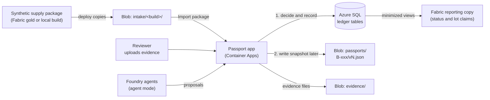

# Passport app

The passport app is a FastAPI application for the synthetic battery passport MVP. It checks battery data, records passport versions and decisions, and provides role-based views. When agent mode is enabled, five AI agent roles use Microsoft Foundry to propose actions that the app validates against its rules.

The app can run locally or in Azure Container Apps. For local setup and a scripted preview, see [Run the tests and the app on your PC](#7-run-the-tests-and-the-app-on-your-pc). For Azure prerequisites and deployment, see the [deployment guide](../docs/deployment.md). For the scenario and its human decisions, see the [scenario walkthrough](../docs/scenario-walkthrough.md).

> **Scope:** The data, companies, mines, and sites are synthetic. The app creates MVP records, not legally valid EU battery passports. It does not contact an EU registry; records carry `registry: not_exercised`. The [known limits](#9-known-limits) distinguish the prototype's controls from production requirements.

The following sections describe the [data flow](#1-what-the-app-does-in-one-picture), [publication rules](#2-the-three-rules), [roles](#3-who-can-do-what), [endpoints](#4-main-endpoints), [executive screens](#41-executive-screens), and [configuration](#6-settings).

## 1. What the app does, in one picture



- **Fabric or a local build prepares candidate data.** Neither decides whether a passport exists.
- **The app applies the rules.** It checks the package, calculates the illustrative footprint, and records decisions.
- **Agents propose actions.** The app enforces its gates. People resolve sourcing holds, decide compliance cases, and approve or reject second-life requests.
- **SQL records decisions.** Ledger tables support detection of later changes.
- **Blob stores files.** These include incoming packages, evidence, and passport snapshots.

## 2. The three rules

The app reads package contract `dbp-passport-package-2` (`batches.jsonl`, `lots.jsonl`, `batteries.jsonl`, `composition.jsonl`, then `manifest.json`). It validates the package independently of the generator, checking the manifest, file hashes, record counts, units, shares between 0 and 100, and reasons for not-applicable fields. It also checks critical-material claim references, lot mass, the NMC811 material set, and batch energy allocation. The manifest is written last. Packages with contract 1 or another unsupported contract are refused.

The app imports every produced battery, including blocked batteries and their coded reasons, into `Batches`, `PackageLots`, `PackageComposition`, and `PackageBatteries`.

Each battery then gets one of three results, with a coded reason:

| Result | Reason | When | What happens |
|---|---|---|---|
| `blocked` | `inputs_incomplete` | The package marks the battery `blocked` (for example a missing claim reference or batch energy). | No passport version. The package reasons stay visible to staff. |
| `blocked` | `method_unpinned` | The batch pins a calculation method or factor set this app does not carry. | No passport version until a package pins `illustrative-pcf-2` with a known factor set. |
| `blocked` | `composition_invalid` | The composition does not cover the chemistry's materials or names a lot the package does not deliver. | No passport version. |
| `held` | `sourcing_review_open` | A material lot used by the battery has an **open sourcing review**. | No new version until a reviewer resolves the review with new evidence. |
| `held` | `compliance_review_open` | A critical lot used by the battery has an **open compliance case** ([section 2.1](#21-compliance-cases)). | No new version until Compliance accepts the case with an action plan. |
| `eligible` | none | Inputs are complete, the method is pinned, composition is valid, and no review or case is open on its lots. | In agent mode, the gated agent path must also pass before the app commits a version. With agent mode off, the app commits version 1 or the next version if inputs changed. |

Reasons are checked in the order of this table; a battery shows the first that applies. A closed passport (`repurposed` or `recycled`, [section 2.2](#22-lifecycle-and-second-life)) is `blocked` with `passport_closed` before any of them, so Issuance refuses it and a later package cannot reopen it.

A committed version is never overwritten. If a later package holds the battery, the last committed version stays public and the state shows why it is held. In agent mode an eligible battery is published only through the gated agent path (Supplier, Carbon, then Issuance), not automatically at import.

**Carbon footprint (illustrative).** `passport/calculator.py` implements method `illustrative-pcf-2`. It sums each composition entry's mass multiplied by `((1 - r) x primary PCF + r x recycled PCF)`, where `r` is the lot's recycled share. It adds the battery's allocated kWh multiplied by the plant's grid factor, then divides the total by rated kWh. Totals are rounded half up to 0.001 kg CO2e and the result to 0.0001 kg CO2e/kWh.

The factors come from `passport/factors.toml`, a copy of the generator's `data/factors.toml`, so the container does not need `data/`. A batch that pins another method or factor-set version is refused, not recalculated. The lot's claimed PCF is stored as claim data; the footprint uses the pinned factor set. These values are illustrative, not a regulated carbon footprint declaration. The stored passport state's `footprint_verified` remains false. The reporting field of the same name uses a separate claim-verification rule: the passport must be published, have a footprint and at least one critical lot, and all its critical-lot claims must be verified. Neither field is regulatory certification.

**Why a footprint appears before Carbon runs.** Package import calls that deterministic calculator and stores its initial result in `PackageBatteries`; the trail labels it **Footprint calculation at import** using the package's import timestamp, not a separately measured calculation time. No agent or verifier fact is created then. In agent mode, Carbon later requests `calculate`: the app recalculates from the pinned inputs, records a Carbon fact and independently recomputes the arithmetic in `carbon_verifier.py`, recording a verifier fact linked to that calculation. Issuance requires both current facts, along with Supplier and other release gates. Unchanged inputs give the same number; the initial estimate alone does not satisfy those gates. Arithmetic verification is not external assurance of the inputs or regulatory certification.

**Snapshot.** Each committed version writes a `dbp-passport-snapshot-2` document with a public part (identity, lifecycle status, footprint per kWh with method and factor-set versions, recycled content, predecessor and successor links) and a restricted part (composition, calculation detail, plant and batch, supplying lots), grouped so that a later per-role field policy can project it. The restricted part also carries the lifecycle detail: holder, state-of-health readings and, for a successor, which data it inherited. Its authority label is `mvp_passport_record_not_registered`.

**Supplier due diligence** covers critical-material lots only: cobalt, graphite, lithium, and nickel. In agent mode, every critical lot needs a current Supplier `no_issue` fact before Issuance can publish. Evidence includes the signed supplier claim received through the [mock connector](#42-mock-connector-and-party-registry) and any uploaded documents, such as transport records, corrected claims, and adverse reports. The scenario runs one Supplier task per critical lot of the series, not per battery.

Each evidence document provided to an agent must be JSON of at most 16 KB. Separately, an agent record is limited to 8,000 encoded JSON bytes, and an agent may read at most eight sections per attempt. An accepted evidence upload does not guarantee that the assembled agent context fits the record limit. Other lots receive package checks only; a Supplier task for them is refused with `not_critical_lot`.

**Evidence kinds.** Reviewers can upload `supplier_claim`, `transport_record`, `corrected_claim`, and `other`. Reviewers and Compliance users can upload `adverse_report`; only Compliance users can upload `audit_report`. An unauthorized kind returns `403 evidence_kind_not_allowed`. Adverse and audit reports must be a JSON object sent as `application/json` and at most 16 KB; otherwise the app returns `422 evidence_not_json` or `422 evidence_too_large`.

### 2.1 Compliance cases

A **compliance case** is the human decision on a critical lot after a due-diligence concern, such as a synthetic adverse report about the mine. It is separate from a sourcing review, which is about contradictory documents.

| Step | Who | What happens |
|---|---|---|
| Open | Supplier agent (`escalate_compliance`, reason `agent_escalation`) or a Compliance user (`POST /compliance/cases`, reason `compliance_user`) | Case `CC-XXXXXXXX` in state `open`. Every battery using the lot is held with `compliance_review_open`. One case per lot: a second manual open answers `409 case_already_open`; a repeated agent escalation reports the open case. |
| Decide | Compliance only | `keep_hold` keeps the case open; `accept_with_action_plan` needs an owner (2-100 characters), a due date (`YYYY-MM-DD`), at least one evidence item that was not there at opening (for example an audit report) and a reason (5-400 characters). Both need `expected_row_version`; a stale one answers `409 version_conflict`. Each decision is a `CD-XXXXXXXX` row in the append-only `ComplianceDecisions` table. |
| Accepted | Application and agents | The lot is re-evaluated. In agent mode, the application gates and Issuance path still control publication. |
| Reopen | Automatic | New `adverse_report` evidence for a lot whose case was accepted reopens the same case (`reopen_count` + 1, reason `new_adverse_report`), audited and sent as a business event. |

The Supplier agent cannot clear a lot with an open case (`no_issue` is refused with `409 compliance_case_open`) and has no decide action. A published passport is never withdrawn by a later case; its next version waits until the case is accepted. `ComplianceCases` is an updatable ledger table (history kept); the reporting view `report.v_lot_claim_status` shows the lot's case state (`none`, `open` or `accepted`). Cases, owners and due dates are synthetic and illustrative; an accepted case is not an assurance or certification.

### 2.2 Lifecycle and second life

After publication, signed partner events can change a passport's **lifecycle status**. In agent mode, the Lifecycle agent proposes actions and the state machine in `passport/lifecycle.py` applies them. A Reviewer decides whether to approve or reject second life.

| From | Event or decision | Who | To |
|---|---|---|---|
| `active` | `record_soh` (state of health 0-100 %) | current holder | `active`, new version |
| `active` | `record_ownership_change` (`from_party_id` must be the holder; the new holder must be a registered party) | current holder | `active`, new version, holder changes |
| `active` | `request_repurpose` (needs `safety_assessment_ref`, a recorded state of health of at least the factor set's 70 %, and an unused successor ID) | current holder with role `second_life_operator` | `second_life_pending`, new version and a second-life request |
| `second_life_pending` | approve (reason, `expected_row_version`) | `Passport.Reviewer` only | original `repurposed` (closed); successor `<id>-SL1` created `active` |
| `second_life_pending` | reject (reason, `expected_row_version`) | `Passport.Reviewer` only | `active`, new version |
| `active` | `record_end_of_life` (`handed_to_party_id` must be a recycler, who becomes the holder) | current holder | `end_of_life`, new version |
| `end_of_life` | `record_recycling_closure` | party with role `recycler` (the holder) | `recycled` (closed) |

- **Holder.** At publication the holder is the manufacturer `OEM-ADVENTUREWORKS` (`PassportState.holder_id`). Ownership changes, second-life approval and end of life move it.
- **One version per event.** Every applied event or decision commits a new passport version (snapshot with status, holder, latest state of health and links) through the outbox. The app produces it deterministically at application time; the Issuance agent is not involved. Earlier versions stay in the ledger.
- **Quarantine.** Every event is a row in the append-only `LifecycleEvents` table with the state before and after and `recorded` or `quarantined` with one reason: `passport_closed`, `passport_not_published`, `state_not_allowed`, `event_out_of_order` (issued before the last recorded event), `issuer_role_not_allowed`, `not_current_holder`, `bad_soh`, `unknown_new_holder`, `safety_reference_missing`, `soh_missing`, `soh_below_minimum` or `successor_unavailable`. The connector checks these at intake (answer `202 quarantined`) and the app checks them again when the Lifecycle task applies the event. A quarantined event is never applied. A repeated task for a recorded event answers `already_recorded`; the connector's replay of the same message answers with its first result.
- **Second life.** `SecondLifeRequests` (updatable, history kept, `row_version`) holds the request with its safety reference, state of health and an **illustrative value**: rated kWh x 45 EUR from the `[second_life]` factor set, labeled "illustrative, not a sale price"; `event_value_matches` records whether the partner's value agrees. On approval the original is closed with a successor link, and the successor gets its own version 1 with a predecessor link (`PassportLinks`, both ways). The successor is held by the second-life operator and inherits chemistry, rated kWh, model, composition, footprint and recycled content, labeled "inherited from the predecessor passport, not re-measured", plus the last state-of-health reading. The Lifecycle agent and every other role get `403`; a stale `expected_row_version` answers `409 version_conflict`, a decided request `409 request_not_pending`, a missing reason `422 reason_required`.
- **Screens.** "Second-life approvals" (`/second-life`) lists requests for Reviewer and Operator; only the Reviewer sees the approve or reject form. The passport page shows staff a Lifecycle panel (status, holder, state-of-health history, events, requests) and everyone the status and the predecessor or successor link; a closed passport shows `Closed - repurposed` or `Closed - recycled`. Quarantined events appear in the console's connector section and in the decision trail.
- **Reporting.** `report.v_passport_status` carries the real lifecycle status, successor ID and illustrative second-life value. The board and the production-series coverage count produced batteries only; a successor is shown separately ("1 successor passport").

## 3. Who can do what

Roles come from the Microsoft Entra app registration that `deploy` creates (stage B1). Container Apps authentication (Easy Auth) signs users in; the app only reads the result.

| Who | Can do |
|---|---|
| Anyone | See the board, the passport list and the public view of a passport, including the public page `/p/{id}` and its QR card. |
| `Passport.Reviewer` | Upload evidence (not audit reports), open and resolve sourcing reviews (also on the hold screen), approve or reject [second-life requests](#22-lifecycle-and-second-life), read evidence files and compliance cases (no decisions), see restricted fields and the executive screens. |
| `Passport.Compliance` | Open and decide [compliance cases](#21-compliance-cases), upload adverse and audit reports, read evidence and the case screens. `deploy` assigns it to the operator. |
| `Passport.Operator` | Import packages, see the snapshot queue, pause the worker, run reconcile, read the reporting rows, view (not decide) the executive screens and second-life requests, read quarantined lifecycle events, and view the Settings page read-only. |
| `Passport.Connector` | Record mock connector agreements and deliver signed partner messages. The caller is not trusted for content: every message must carry a valid signature of a registered party. `deploy` assigns it to the operator. |
| `Passport.PolicyApprover` | Review, activate, or reject Regulatory Watch guidance. The role cannot change application gates and is not assigned by `deploy`. |
| `Passport.OEM` | Passport viewer: identity, footprint, performance and the read-only second-life summary ([field policy](#31-field-policy)). For warranty and fleet exposure, assign exactly one additional qualifier: `Passport.Fleet.AdventureWorks` or `Passport.Fleet.Fabrikam`. Qualifiers alone grant no access. |
| `Passport.Recycler` | Passport viewer: identity, footprint, performance and composition (synthetic dismantling and safety information). Declared, assigned only with `roles assign`. |
| `Passport.Authority` | Passport viewer of staff field groups except evidence; also reads the party registry, connector log, quarantined lifecycle events and compliance cases. No OEM-specific fields. |
| `Passport.Admin` | Change the [Settings page](#61-settings-page-reuse-the-app-in-another-azure-environment) (Azure connections, workbook links, public address). It grants no passport data; give a person Operator as well to see the staff screens. The deployment declares the role but never assigns it. |
| Signed in without a role | Public pages only; staff screens answer `403` with a "needs the app role" page. |

The public view is an MVP choice of fields. It is **not** a legal classification of which battery passport data must be public.

### 3.1 Field policy

`passport/access.py` holds one `FIELD_POLICY` table and one projection used by both `GET /passports/{id}/view` and the passport page `/p/{id}`. Roles come only from the signed-in principal (Easy Auth token, or the local identity headers in local runs); `?role=`, `X-Role`, other headers and body fields never widen a view. Several roles give the union of their groups. The groups are an MVP choice, not a legal access classification; the data is synthetic and footprints and values are illustrative.

| Field group | Contents |
|---|---|
| `identity` | Battery ID, model, chemistry, rated capacity, status, version, lifecycle status, successor and predecessor links |
| `footprint` | Footprint per kWh (illustrative) and recycled-content share per material |
| `performance` | State-of-health history, current holder and performance |
| `second_life` | OEM health screen and measurement date, assessment reference supplied or not, reviewer outcome and decision date, and stored illustrative amount with its scenario calculation. An approved successor identifies its predecessor's decision. No assessment file, review notes or approval controls. |
| `warranty` | Original physical pack, in-service date, applicable term version, time and usage limits, dated actual EFC, design specification, and change between comparable dated health readings. |
| `recall` | Original batch, matched recalls/service campaigns, effective dates and statuses, and the feed's as-of time and freshness. Does not expose other targeted serials or batches. |
| `composition` | Mass per material, synthetic dismantling and safety information |
| `calculation` | Method and factor versions and calculation references |
| `supply_chain` | Lots and suppliers |
| `due_diligence` | Per critical lot: claim status, sourcing review and compliance case state |
| `ledger` | Digests, versions and snapshot receipts |
| `decisions` | Review and compliance decisions with reasons |
| `evidence` | Evidence references only (ID, kind, lot, SHA-256), never content |

| Caller | Field groups |
|---|---|
| Anonymous, `Passport.Admin`, `Passport.Connector`, `Passport.PolicyApprover`, signed in without a role | identity, footprint |
| `Passport.OEM` alone | + performance; Release 1's existing `second_life` summary on issued original packs held by or with a recorded event from the synthetic manufacturer and their linked successors. No warranty, recall or fleet view. |
| `Passport.OEM` + one fleet qualifier | + performance; `second_life`, `warranty` and `recall` only on issued packs whose **original physical serial** is assigned to that organization by the imported feed. Linked successors read the original's service facts, not a new measurement. |
| `Passport.Recycler` | + performance, composition |
| `Passport.Authority` | staff groups except evidence; no OEM summaries |
| `Passport.Compliance` | identity, footprint, due_diligence, decisions, evidence (compliance-case evidence only) |
| `Passport.Operator`, `Passport.Reviewer` | staff groups; no OEM summaries. Staff keep their existing second-life screens. File content stays behind `GET /evidence/{id}/content`, which only `Passport.Reviewer` and `Passport.Compliance` can read. |

The authenticated fleet qualifier maps to `OEM-ADVENTUREWORKS` or `OEM-FABRIKAM`. There is no user lookup in configuration, no organization selector and no inference from the current holder. Both qualifiers together fail closed. **View as OEM** keeps the authenticated qualifier(s); selecting another persona drops them. Local identity headers simulate claims only in local mode. Public pages, printed cards and the older shared `performance` group do not include the new fields.

### 3.2 Aftersales intake and review

After importing the production series, transfer its complete Fabric Gold `dbp-aftersales-1` delivery to the app's **intake** container at `aftersales/{delivery_id}/aftersales.json`. An Operator calls `POST /imports/aftersales/{delivery_id}` with **no body** (also accepts `{}`). The API does not accept records or client-supplied storage locations.

The envelope has `schema`, `series_id`, `delivery_id`, `as_of_utc`, `records`, and `sha256`. The digest is SHA-256 of UTF-8 `json.dumps(records, sort_keys=True, separators=(",", ":"), ensure_ascii=True)`. A full delivery identifies every original produced pack in the series:

| Array in `records` | Fields |
|---|---|
| `packs` | `battery_id`, `oem_id`, `batch_id`, nullable ISO `in_service_date`, `term_version`, nullable positive `warranty_months` and `warranty_cycles` |
| `readings` | `reading_id`, `battery_id`, `measured_utc`, cumulative `actual_cycles`, `cycle_basis` = `equivalent_full_cycles`, nullable `soh_pct` |
| `campaigns` | `campaign_id`, `kind` (`recall` or `service_campaign`), `status` (`open` or `closed`), ISO `effective_date`, `batch_ids` and `battery_ids` |

The app verifies the digest, series/serial/batch against production, immutable OEM assignment, warranty version and reading consistency. It atomically stores append-only facts and a receipt (`201`); an identical replay returns the same delivery, series, as-of time and digest with `replayed: true` (`200`). A conflicting or non-advancing delivery fails (`409`); invalid records fail (`422`). Failure leaves the last accepted delivery in place. Later snapshots replace the applicable terms and campaign set, not the observation history. No issued snapshot, reporting row or existing production record is rewritten.

**Warranty** is a review flag, not a claim decision. The time check adds calendar months to the in-service date (clamping to month end) and compares the result with the delivery's as-of date. The usage check uses the latest dated equivalent full cycles (EFC), not the packaging specification for expected cycles. Reaching or passing a limit flags `exceeded`; at most 30 days remaining or at most 10% of cycles remaining flags `near_limit`. Missing inputs give `insufficient_data` independently for each limit. Health change in percentage points requires two distinct dated state-of-health (SoH) observations of the same physical pack from the service feed; inherited lifecycle readings do not count.

**Fleet exposure** at `/oem/fleet` (HTML) and `/oem/fleet/view` (JSON) accepts optional `series_id`, `holder_id` and `campaign_id`. Entitlement applies before all filters and counts. A currently effective open recall **or** service campaign counts the same issued physical serial once across overlapping targets and campaigns. A transfer changes only its holder; a repurposed pack counts once under the successor's holder; a recycled pack stays on its historical passport, not in active exposure. Follow a holder to its affected serials and their current passport pages.

Always check the as-of time. A feed older than 30 days is labeled **stale**; displayed matches and counts are last-known exposure, not a current clearance. An unavailable feed returns an unknown count (`null`), not zero. Only a current feed supports “no active campaign.” The `feeds` list identifies the series included in the count; a series not yet delivered cannot establish fleet membership.

## 4. Main endpoints

| Method and path | Role | Purpose |
|---|---|---|
| `GET /` | anyone | Branded Operations Console in the shared layout. Anonymous visitors see public passports; staff see role-appropriate reviews, evidence, queue controls and audit history. |
| `GET /passports`, `GET /passports/{id}` | anyone | Board ("N of M passports committed") and the public view. |
| `GET /passports/{id}/view` | anyone | The caller's [field policy](#31-field-policy) projection: `field_groups`, one object per group and `labels` (`synthetic`, `illustrative`). `404` for an unknown battery. |
| `GET /passports/{id}/restricted` | staff | Full state, versions, snapshot receipts. |
| `GET /passports/{id}/versions/{n}/verify` | staff | Compares the Blob snapshot with the hash in SQL. |
| `POST /packages/import` | Operator | `{"intake_folder": "BUILD-03", "command_id": "..."}` |
| `POST /evidence` | Reviewer, Compliance | Multipart form: `kind`, `lot_id`, `command_id`, `file`. Allowed kinds depend on the role ([evidence kinds](#2-the-three-rules)). |
| `POST /reviews` | Reviewer | `{"lot_id", "reason", "evidence_ids", "command_id"}` |
| `POST /reviews/{id}/resolve` | Reviewer | Adds `expected_row_version`; needs evidence not used before. |
| `GET /evidence`, `/reviews`, `/audit` | staff | Lists. `/evidence/{id}/verify` checks one file. |
| `GET /evidence/{id}/content` | Reviewer, Compliance | The stored evidence file, served as an attachment. Operators see the reference and hash, not the content. |
| `GET /compliance/cases`, `GET /compliance/cases/{id}` | Compliance, Reviewer, Authority | Cases; one case with its decisions, the lot's evidence list, the batteries it holds and the agent proposal. |
| `POST /compliance/cases` | Compliance | `{"lot_id", "reason", "evidence_ids", "command_id"}` |
| `POST /compliance/cases/{id}/decisions` | Compliance | `{"decision", "expected_row_version", "reason", "evidence_ids", "owner", "due_date", "command_id"}` |
| `GET /second-life`, `GET /second-life/{id}` | Reviewer, Operator | Second-life requests (JSON unless the browser asks for HTML). |
| `POST /second-life/{id}/decision` | Reviewer | `{"decision": "approve" or "reject", "expected_row_version", "reason", "command_id"}` (JSON or form). |
| `GET /passports/{id}/links` | anyone | Predecessor and successor links. |
| `GET /lifecycle/quarantine` | Operator, Authority | Quarantined lifecycle events with their reason codes. |
| `GET /report/status` | Operator | Reporting export v2 for Fabric: `{"schema_version": "2", "export_id": "EXP-YYYYMMDDTHHMMSSZ", "generated_utc", "rows", "lot_claims", "data_label": "synthetic"}`. `rows` are the columns of `report.v_passport_status` (including `footprint_verified`), `lot_claims` those of `report.v_lot_claim_status` (including `fields_complete`). The former `GET /report/lot-claims` is folded into it. |
| `POST /connector/v1/agreements`, `POST /connector/v1/messages` | Connector | Mock agreement and signed partner message intake; see [section 4.2](#42-mock-connector-and-party-registry). |
| `GET /connector/v1/messages`, `GET /parties` | Operator, Authority | Connector log (no payloads) and the party registry (public keys only). |
| `GET /admin/outbox`, `POST /admin/outbox/drain`, `POST /admin/worker`, `GET /admin/reconcile` | Operator | Inspect or drain the shared queue and find orphan files. Pause/resume affects the worker in the replica that receives the request, not other replicas. |
| `GET /health/live`, `/health/ready`, `/me` | anyone | Probes and "who am I". `/health/ready` answers `503 schema_mismatch` when `dbp.SchemaInfo` is not version 4; the app then refuses every write. |
| `GET /agents/runs` | staff; agent mode on | Prepared task summaries, completed results and accepted facts of the agent roles. Each result carries `provenance`: one mark per AI text field (`provenance_id`, `ai_generated`, `digital_source_type`). |
| `GET /agents/tasks/{task_id}/{section}` | matching hosted machine role | Pinned, role-scoped task section; audited and bounded to eight reads. |
| `POST /agents/{role}/run` | Operator; agent mode on | `subject`, `task_id`, optional Lifecycle `event`; invokes the Foundry agent, then revalidates and commits. |
| `GET /policy/candidates` | PolicyApprover; agent mode on | Active guidance (with `ai_drafted`, `source_task_id`, `provenance_id`) and Watch candidates with their model, version, requester and `provenance` marks for title and text. |
| `POST /policy/candidates/{id}/activate`, `POST /policy/candidates/{id}/reject` | PolicyApprover; agent mode on | `{"expected_row_version", "reason"}` (reason 5-400 characters). Activate makes the candidate the active guidance; reject leaves the active guidance unchanged. Only a pending candidate can be decided. |
| `POST /provenance/verify` | Authority, Compliance, Operator | Send exactly one of `text` (1-20,000 characters) or `provenance_id`. Returns `match`, `method` and the matching provenance records, never the text or a fingerprint; see [AI and the EU AI Act](../docs/eu-ai-act.md#44-detection-post-provenanceverify). |

Every business write needs a `command_id` containing 8 to 64 letters, digits, or dashes. Sending the same command again returns the first answer with `"replayed": true` instead of doing the work twice.

Agent activations instead use `task_id` with the same character and length limits. A completed task returns its stored result; failed tasks do not silently rerun. Use a new ID after fixing a failed dependency.

### 4.1 Executive screens

The app renders Jinja HTML on the server and uses small first-party scripts for dropdown submission, responsive navigation, tour highlighting, and expandable decision-trail steps. It uses no external scripts, fonts, or CDNs. The Content Security Policy (CSP) permits same-origin scripts and forbids inline script attributes.

The fictional **Contoso Battery AB (publ)** branding uses blue for controls and links, teal for human decision forms, and amber for holds. The decision-trail key uses both color and shape to distinguish an AI agent, a person, and an application rule. Every actor and status also has text. Staff navigation groups pages according to the effective role. Battery links appear in a collapsible catalog that opens on passport and trail pages. The current page has `aria-current`; below 960 px, **Workspace navigation** collapses above the content. Anonymous visitors, users without a role, and printable cards have no staff navigation. The **Synthetic data** indicator remains visible; [section 9](#9-known-limits) describes the limits.

**View as** is available locally and in Azure. Its native dropdown offers only human personas held by the authenticated account, plus Public reader and All assigned roles. Selecting a role applies it immediately; **Switch** appears only when JavaScript is disabled. A session cookie selects a server-enforced subset of those roles; the real user ID/name remains on every decision. A forged, stale or revoked selection fails closed. Public reader is not sign-out, and switching perspectives is not proof of separate-account isolation. Bearer-token scripts and callbacks retain their token roles. Cookies are HttpOnly and SameSite=Strict, also Secure in Easy Auth; the switching endpoints reject cross-origin requests. HTML and `/me` are not cached.

**Production series**, beside View as, selects one imported series or **All production series**. Operations, Reviewer, Compliance, Authority, OEM, and Recycler personas can use it. A browser-session cookie preserves the selection across pages, persona changes, and form results. It filters readiness figures, battery catalogs (including linked successors), sourcing reviews, compliance cases, second-life approvals, evidence, and series-linked console audit, queue, and connector records. Shared lots remain visible in every series that uses them, but affected-battery lists stay scoped. Successors do not increase production counts.

Unknown series and out-of-scope detail pages are reported rather than silently switching series. If a remembered series no longer exists, for example after `data clean`, the app selects the default with a notice and ends the removed series' tour. Explicit links to unavailable series still report them as unavailable. Shared policy, configuration, and infrastructure controls remain application-wide. The series filter is not an authorization or tenant boundary and does not change JSON API exports.

**Guided journey** in the navigation opens the selected persona's route: Operations lead (5 steps), Reviewer (9), Compliance Officer (4), Policy Approver (2), OEM customer (4), Recycler (2), or Public reader (2). Authority and Administrator have no tours. Single-role accounts need no extra persona selection; multi-role accounts must choose View as first. Select one production series in the header to start a series-specific tour; Public reader can enter an Operations-supplied identifier. Back/Next never switch roles, run agents, upload evidence, approve, publish or reset records. The server rejects steps or stale forms belonging to another persona even when the real account holds both roles. Changing View as during a tour starts the new role's first step with the same series; All assigned roles, Authority and Administrator end the active tour. Changing production series ends the previous series' tour. Policy guidance needs no series. Old cross-role tour cookies are discarded.

The journey entry appears once: in workspace navigation, or as a plain link beside View as when no sidebar is available. Readiness starts in **Live mode**, refreshing every **5 seconds**. **Stop refreshing** pauses it; this preference survives navigation until Live mode is enabled again. The waiting-status card has no duplicate refresh action. Decision forms never refresh on a timer.

The guide highlights the relevant area and subtly blurs/fades surrounding content without blocking interaction; the target and guide remain sharp. Hover or keyboard focus restores clarity to other areas. Missing targets, printing and high-contrast preferences leave content unblurred. The guide persists across form results, explains missing prerequisites and offers Refresh, All stops and End. On narrow screens guidance is expandable and controls stay visible. Timed refresh is suppressed while the tour is active. Without JavaScript, forms, Switch and navigation still work; highlighting and background blur do not. See the [role routes and preparation](../docs/scenario-walkthrough.md#4-showing-the-executive-screens-on-the-deployed-app).

The **Operations Console** at `/` uses the same branded header, responsive navigation and shared CSS as the executive screens. It keeps the role-aware forms and API contracts: reviewers upload evidence and manage reviews; operators import packages and view the snapshot queue; staff can inspect the audit history. Anonymous visitors see only the public passport list.

| Method and path | Role | What it shows |
|---|---|---|
| `GET /` | anyone | Operations Console in the shared layout; passport list for anonymous visitors and role-scoped tools for staff. |
| `POST /personas` | authenticated identity | Select an actually assigned human role, Public reader or All assigned roles; cookie only, never a new identity or grant. |
| `GET /journey`, `POST /journey` | human app role; selected stop needs its role | Overview and navigation across the five-battery story. Uses the header's selected production series; unknown series and missing records are reported, not substituted. |
| `GET /exec[?series=SERIES-..&live=1]` | staff | **Passport readiness** for the selected production series, or every series with `series=all`: "N of M published", coverage (valid passports ÷ all in-scope produced batteries, held units included), the next step, supplier evidence completeness per lot (each lot links to its lot page), open holds and their age, agent runs, tokens and model cost (or "not measured"), carbon labeled "Illustrative estimate", and links to each passport and trail. Above it, the four success measures as tiles (passport coverage of produced batteries with successor passports excluded, verified footprint per kWh, supplier data completeness, second life with illustrative value) and a per-plant table (produced, published, coverage, verified-footprint batteries, average footprint per kWh), all computed by `passport/metrics.py` and labeled synthetic or illustrative. Live refresh defaults to every 5 seconds; `live=0` pauses it. |
| `GET /p/{id}`, `GET /p/{id}/card` | anyone | Passport page and printable card: identity and footprint for everyone (chemistry, rated capacity, footprint per kWh labeled illustrative, recycled share per material, lifecycle status, successor or predecessor link), plus one section per further field group of the caller's [field policy](#31-field-policy); version, published time, ledger status, inline SVG QR code (`segno`) and a copyable passport link. Anonymous requests never run the SQL ledger check. A held battery shows only `Not yet issued - evidence under review`, with no reason or restricted data. |
| `GET /holds/{review_id}` | staff | Supplier claim, transport record and the supplier's corrected claim side by side, with differences marked. Operators see it read-only. |
| `GET /lots/{lot_id}` | staff, Compliance | **Supplier lot**, opened from the lot links in the readiness table: evidence completeness and the missing document, the latest Supplier agent check, every document on file with its file name, type, upload date and integrity results (a **Read document** link for Reviewer and Compliance only), the batteries using the lot with their status, trail and public view, and the lot's holds and compliance cases, labeled "Synthetic data" and "Illustrative". `404` for an unknown lot. |
| `POST /holds/{review_id}/resolve` | Reviewer | Form: chosen new evidence, reason (5-400 characters), `command_id`, `expected_row_version`. Records the decision only; the gates and the Issuance agent still publish. Errors re-show the form with a plain message. |
| `GET /cases`, `GET /cases/{case_id}` | Compliance, Reviewer, Authority | Case list and one case: lot, held batteries, agent proposal, evidence, decisions with owner and due date, state and the "Synthetic data" and "Illustrative" labels. The navigation shows a "Compliance cases" section to these roles; others get `403`. |
| `POST /cases/{case_id}/decide` | Compliance | Form: decision, evidence, owner, due date, reason, `command_id`, `expected_row_version`. Records the decision only. |
| `GET /second-life`, `GET /second-life/{id}` | Reviewer, Operator | **Second-life approvals**: request list and one request with the battery, successor ID, safety assessment reference, state of health against the minimum, the illustrative value and its basis, and the "Synthetic data" and "Illustrative value" labels. Others get `403`. |
| `POST /second-life/{id}/decision` | Reviewer | Form: approve or reject, reason, `command_id`, `expected_row_version`. |
| `GET /trail/{id}` | staff | **Decision timeline** of package import, calculation, signed messages, agent tasks, human decisions and lifecycle records, ordered by recorded time (agent task creation, not completion). Tasks can overlap; equal timestamps do not establish execution order. Each agent entry names its lot or battery, automatic-workflow or Operator/API source, creation time and result-recorded time. Supplier assessments are lot-level and shared across battery trails, not separate runs for each battery. Timeline task chips link to their steps; expanding a step shows its task ID, pinned source records (Supplier evidence metadata, battery package/input hash or Lifecycle event), reasoning, model usage and application checks. No exact initiating event is inferred when only the requester was recorded. Snapshot/ledger integrity and actor keys remain separate; **Expand all steps** and printing open all details. |
| `GET /ledger/verify[?battery=id]` | staff | JSON result of the [ledger check](#51-ledger-verification). |
| `GET /policy`, `POST /policy/{id}/activate`, `POST /policy/{id}/reject` | PolicyApprover | Active guidance (labeled "AI-drafted" with its approver, or "Baseline written by people") and pending Watch candidates labeled "AI-drafted" with model, version and task; a form per candidate to activate or reject it with a reason. |
| `GET /settings`, `POST /settings` | Admin edits; Operator views | The [Settings page](#61-settings-page-reuse-the-app-in-another-azure-environment): Azure connections, workbook links and the public address, with connection tests, save and "use the deployment values again". |

**Supplier evidence navigation and integrity.** In the readiness table, lot IDs open `/lots/{lot_id}` and battery IDs open `/p/{id}`; decision trails remain separate links on battery cards and lot pages. Each lot-page load uses the existing evidence verifier to compare both the current Blob file and its recorded version against the SHA-256 in SQL. Each document shows separate match, mismatch, missing-file or unavailable-version results and an expandable recorded hash. Operators can inspect these results and metadata, but not file content; Reviewer and Compliance can download the version recorded on upload. These read-only comparisons neither prove a supplier claim is true nor verify the SQL ledger itself.

### 4.2 Mock connector and party registry

Partner data arrives through a **mock** dataspace-style connector. It is not Eclipse Dataspace Connector, Gaia-X or Catena-X software and claims no conformance with them; every response carries `"connector": "mock"`.

- **Party registry.** `DBP_PARTY_REGISTRY_B64` holds the `dbp-party-registry-1` document written by the simulator: party ID, name, role, raw Ed25519 public key, allowed lots or event types and a revoked flag. No private key reaches the app. The app copies it into the `Parties` ledger table (updatable with history); a changed key or permission, a revocation or a party missing from a later registry is an audited update. Each connector request compares the stored parties with the registry and writes only when they differ, so a database recreated by `data reset` under the running app receives the registry again.
- **Agreements.** `POST /connector/v1/agreements` (`agreement_id`, `sender`, `purpose`, `message_types`, `valid_from`, `valid_until`, `command_id`) records one agreement per sending party in `ConnectorAgreements`. A message needs an agreement valid now for its type, otherwise `403 no_agreement`.
- **Messages.** `POST /connector/v1/messages` takes `{"envelope": {"payload", "signature": {"alg": "Ed25519", "key_id", "value"}}, "correlation_id"}`. Payload schemas are `dbp-supplier-claim-2` and `dbp-partner-event-1`, ASCII JSON of at most 8,000 bytes. `passport/signed_messages.py` checks the signature, that the issuer owns the key, the audience `CONTOSO-BATTERY`, issue and expiry times, revocation, the lot or event type allowed to the party, and replay. Refusals carry one reason code: `bad_envelope`, `bad_payload`, `too_large`, `bad_signature`, `unknown_key`, `issuer_mismatch`, `wrong_audience`, `not_yet_valid`, `expired`, `revoked`, `lot_not_allowed`, `event_type_not_allowed`, `unknown_battery`, `no_agreement` or `message_conflict`.
- **Log and replay.** Every message, accepted or refused, is a row in `ConnectorMessages` (message ID, sender, type, correlation ID, payload hash, result, reason code). Sending the same `message_id` and payload again returns the first result with `"replayed": true`; the same ID with another payload is refused with `409 message_conflict`. `python -m dbp_mvp scenario credential_negatives` exercises these refusals and the exact replay, locally or (opt-in) against the deployed app; see the [scenario walkthrough](../docs/scenario-walkthrough.md#9-optional-credential-negatives).
- **Routing.** A verified supplier claim becomes evidence for its lot, so the Supplier agent reads the signed claim. A verified partner event of any of the five lifecycle types is `routed` to a Lifecycle task when the [state machine](#22-lifecycle-and-second-life) allows it now, or `quarantined` (`202`) with its reason. The Lifecycle tool route accepts only events the connector routed.
- **Lot claim status** (`report.v_lot_claim_status.claim_status`): `verified` when a verified claim's payload hash equals the claim hash in the package lot, `revoked` when the claim's party is revoked, `invalid` when claims arrived but none matches, `missing` otherwise.
- **Console and trail.** Operators and Authority see a "Connector (mock)" console section with the registered parties and latest messages. Staff can expand a connector step in a battery's decision trail for the subject link, message type, sender ID, delivery identity, recorded agreement (receiver, purpose and validity), evidence ID/file/kind, receipt/message/correlation IDs and payload hash. Only metadata is shown, never raw payloads, signatures or evidence contents. The recorded intake result distinguishes verified claims, events routed for Lifecycle assessment, quarantined events and rejections; routed does not mean applied. Rejected messages' sender and subject are untrusted claims, not authenticated identities. Signature acceptance authenticates the message, not its factual accuracy. This is a mock exchange, not a live partner integration.

## 5. Why it is built this way

| Choice | Why |
|---|---|
| **Decide in SQL first, write the Blob snapshot afterward (outbox).** | SQL and Blob cannot share one transaction. Recording the decision and a snapshot-write task in the same SQL transaction allows the worker to resume after a crash. It retries up to five times; inspect exhausted tasks rather than assuming every snapshot was written. |
| **Ledger tables** for packages, versions, evidence, reviews and audit. | Append-only tables refuse updates and deletes; updatable tables keep history. Digests are anchored explicitly in private Blob storage and verification uses every retained anchor ([section 5.1](#51-ledger-verification)). |
| **`command_id` on every write.** | Browsers and scripts retry. Idempotency makes a retry harmless. |
| **`expected_row_version` when resolving a review.** | Two reviewers cannot silently overwrite each other. The second one gets `409 version_conflict`. |
| **New evidence required to resolve.** | A review cannot be closed by repeating the evidence that opened it. |
| **Snapshot hash in SQL, file in Blob with versioning.** | If someone changes a Blob file later, `verify` shows `mismatch` for the current file and `match` for the recorded Blob version. |
| **Managed identity for data access.** | The app reaches SQL and Blob with its user-assigned identity. Storage shared keys are disabled. |
| **Minimized reporting views.** | Fabric receives passport status rows and lot-claim status rows, including lot and supplier IDs. The export excludes evidence files and people. |
| **One write at a time** (`sp_getapplock`). | Simple and correct for an MVP with a handful of users. A production design would lock per battery or lot. |

### 5.1 Ledger verification

`GET /ledger/verify[?battery=id]` and the trail screen run `sys.sp_verify_database_ledger` against the digests anchored in the digest storage account under `manual/<server>/<database>/<incarnation>/`, where the incarnation is the database's `create_date` in UTC as `YYYYMMDDTHHMMSSZ` (so a recreated database never meets the old digests), then check whether the battery's passport version lies in an anchored ledger block. The check never claims success it did not observe. Results are cached for one minute; anonymous pages only show the last staff result and never trigger SQL.

| Status | Reason code | Meaning and next step |
|---|---|---|
| `verified` | `ok` | The ledger matches every anchored digest and covers this version. |
| `chain_verified_anchor_pending` | `anchor_pending` | The ledger verifies, but this version was written after the newest digest. On the developer VM: `python -m dbp_mvp ledger anchor`. |
| `unavailable` | `memory_store` | Local run: the in-memory store has no SQL ledger. Expected in local run and preview. |
| `unavailable` | `no_anchored_digest` | No digest stored yet: `python -m dbp_mvp ledger anchor`. |
| `unavailable` | `digests_unreadable`, `digest_store_not_configured` | The app cannot read the digest container. `deploy` stage B3 sets `DBP_DIGEST_ACCOUNT_URL`; `bootstrap` creates the private endpoint and the app's Storage Blob Data Reader role. Rerun the stage concerned. |
| `unavailable` | `permission_missing` | The app identity lacks `VIEW LEDGER CONTENT` (`sql/grant-app.sql`). Rerun `python -m dbp_mvp deploy --from B2`. |
| `unavailable` | `sql_unreachable`, `record_lookup_failed` | SQL could not be reached or read. Check the app's health and try again. |
| `failed` | `verification_failed`, `anchor_not_covered`, `record_missing` | The ledger does not match an anchored digest, or the version has no ledger transaction. Investigate before presenting anything as verified. |

`python -m dbp_mvp ledger verify` on the developer VM checks the stored digests directly with the operator's sign-in. Anchoring is manual, not continuous, and the digest container's time-based retention policy is left unlocked so that teardown can remove it; it is therefore not administrator-proof.

### 5.2 Business events

The Microsoft OpenTelemetry distro is included in `requirements.txt` and installed by the Dockerfile. Setting `APPLICATIONINSIGHTS_CONNECTION_STRING` enables export of the business event contract, which the four persona workbooks query. Events use schema version `2` (`dbp.schema_version`): `agent.run`, `decision.recorded`, `gate.failed`, `passport.published`, `hold.*`, `compliance.case.opened`, `compliance.case.decided`, `compliance.case.reopened`, `lifecycle.event`, `second_life.decided`, `passport.closed`, `passport.successor.created`, `ledger.verified`, `access.denied`, `outbox.retry`, `passport.series.snapshot`, `passport.plant.snapshot`, and `view.served`.

`view.served` carries coded dimensions for the field set (for example `id-fp-perf`) and role group (for example `oem` or `public`). The series snapshot adds the success measures from `passport/metrics.py`: coverage, verified-footprint batteries, supplier completeness, second-life count and illustrative value. It also reports open compliance cases and the oldest case age. `passport.plant.snapshot` reports produced and published counts, coverage, verified footprint, and average footprint per kWh per `plant_id`.

Event names and fields are allowlisted, and codes are pattern-checked. Business events exclude evidence content, free-text reasons, prompts, user names, email addresses, and tokens. Unknown numbers are omitted, not sent as zero. Business events are not trace-sampled; sensitive-data recording and Live Metrics are disabled. Without the connection string, initialization and event export are a no-op. An event-export failure does not interrupt a business operation.

## 6. Settings

| Variable | Values | Meaning |
|---|---|---|
| `DBP_AUTH_MODE` | `easyauth` (default), `local` | `local` trusts `x-local-user`/`x-local-roles` headers. Refused inside Container Apps. |
| `DBP_STORE` | `memory` (default), `sql` | `sql` needs `DBP_SQL_SERVER` (short name) and `DBP_SQL_DATABASE`. |
| `DBP_BLOBS` | `local` (default), `azure` | `azure` needs `DBP_BLOB_ACCOUNT_URL`; `local` uses `DBP_BLOB_ROOT`. |
| `AZURE_CLIENT_ID` | client ID | Which user-assigned managed identity to use. |
| `DBP_WORKER`, `DBP_WORKER_INTERVAL` | `on`/`off`, seconds | Background snapshot writer. |
| `DBP_PARTY_REGISTRY_B64` | Base64-encoded JSON | The `dbp-party-registry-1` document (public keys only), set by `deploy` stage B3 from the series registry. Without it every connector message is refused with `unknown_key`. |
| `DBP_AGENT_MODE` | `on` / `off` (default) | Enables the agent routes and requires gated agent publication instead of automatic import and review publication. `deploy` stage B4 turns it on. |
| `DBP_FOUNDRY_CONFIG_B64` | Base64-encoded JSON | Foundry project endpoint and the pinned role, model and agent configuration, set by `deploy` stage B4. No credentials. |
| `DBP_PUBLIC_BASE_URL` | `https://...` (optional) | Base address encoded in the QR code. Empty: the address of the current request. |
| `DBP_PRICES_B64` | Base64-encoded JSON (optional) | Model price list `{"currency", "source", "models": {"<model>": {"input_per_million", "output_per_million"}}}`, the JSON format of `prices_file` in `config/mvp.toml`. Apply or refresh an existing app with `python -m dbp_mvp app prices --file .\config\prices.json` from the MVP folder on a laptop or VM; no build or deployment phases, only a new app revision on the same image. Later deployments preserve applied prices ([guide](../docs/deployment.md#model-prices)). Without it, every cost shows "not measured". |
| `DBP_DIGEST_ACCOUNT_URL` | Blob endpoint | Digest storage account for the ledger check, set by the deployment; the app reads the `sqldbledgerdigests` container only (Storage Blob Data Reader). |
| `APPLICATIONINSIGHTS_CONNECTION_STRING` | connection string (optional) | Enables the packaged `microsoft-opentelemetry` exporter; absent means telemetry stays off. Never commit or print the value. Set by the deployment or on the Settings page. |
| `DBP_WORKBOOK_EXECUTIVE`, `DBP_WORKBOOK_COMPLIANCE`, `DBP_WORKBOOK_AGENTS`, `DBP_WORKBOOK_OPERATIONS` | `https://portal.azure.com/...` (optional) | Azure portal addresses of the four persona workbooks that the deployment creates, shown under Monitoring in the navigation. Only `https` links to `portal.azure.com`, `portal.azure.us` or `portal.azure.cn` are accepted. |
| `DBP_SETTINGS_FILE` | path (PC only) | Where the Settings page saves its values on a PC. Default `output/settings.json`, which Git ignores. |
| `DBP_SETTINGS_BLOB_URL` | `https://<account>.blob.core.windows.net/settings/passport-settings.json` | Where the Settings page saves its values in Azure, read and written with the app's managed identity. Set by the deployment. |
| `DBP_RESOURCE_GROUP` | resource group name | Only used to print the exact `az containerapp revision restart` command after a save. Set by the deployment. |

### 6.1 Settings page: reuse the app in another Azure environment

The app is meant to be forked and reused: deploy the infrastructure (`python -m dbp_mvp bootstrap`, then `deploy`; see the [deployment guide](../docs/deployment.md)), then finish the configuration in the browser at **Tools > Settings** instead of editing environment variables. No extra Azure service is involved; the values live in one small JSON file.

- **What can be changed:** the database (in memory or Azure SQL server and database), document storage (local folder or Blob account address), the ledger digest storage address, the Application Insights connection string, the four workbook links and the public address used in the QR code. Sign-in mode, the app identity, agents, Foundry and prices stay fixed at deployment and are listed read-only.
- **Who:** `Passport.Admin` changes values; `Passport.Operator` sees them read-only with the secret masked; everyone else gets `403`.
- **Precedence:** a saved value, then the deployment's environment variable, then the built-in default. Only values that differ from the deployment are saved, and "Use the deployment values again" clears them.
- **Where it is saved:** a Blob in the app's storage account (`DBP_SETTINGS_BLOB_URL`, created by the deployment), or `output/settings.json` on a PC. In a container without the settings Blob, saving is off and the page says why.
- **Checks before saving:** each value is validated (`https` addresses without SAS tokens, connection string format, portal-only workbook links) and the combination is checked exactly as at startup. Because the app sends its managed identity's tokens to the database and storage, the SQL server must be an Azure SQL Database server (`<name>` or `<name>.database.windows.net`) and both storage addresses must be `https://<account>.blob.core.windows.net` without a port. Every endpoint in the Application Insights connection string must be an Azure Monitor address. **Test connections** reaches SQL, the passports container and the digest container with the app's own identity; a failed test blocks the save unless "Save without testing" is selected. A failed test shows only the error type and Azure error code; the full error goes to the app log.
- **Secrets:** SQL and Blob use the managed identity, so no password is stored. The Application Insights connection string is the only secret: it is shown as "key ending abcd", never echoed back, and a blank field keeps the current value.
- **Applying changes:** saved values take effect after a restart. The page shows "Restart required" with the exact `az containerapp revision restart` command in Azure, or "stop and start again" on a PC. A missing, unreadable or invalid file never stops the app: it starts on the deployment values and the page explains why the saved values were ignored.

## 7. Run the tests and the app on your PC

From this folder, with Python 3.14 or later, the version the app image runs.

```powershell
python -m venv .venv
.\.venv\Scripts\python.exe -m pip install -r requirements-dev.txt
.\.venv\Scripts\python.exe -m unittest discover -s tests -p "test_*.py"
```

The tests use an in-memory store and a temporary folder for Blob. `test_sql_contract.py` checks that `sql/schema.sql`, the store metadata, and the generated SQL agree; it does **not** run SQL. Deployment stage B2 runs the SQL statements against the target database.

`test_telemetry_export.py` starts the configured app in an isolated process and captures the installed SDK's HTTP export on loopback. It verifies custom-event names, dimensions, numeric measurements, unknown-value omission, private-field exclusion and export under an unsampled span. It uses a dummy connection string and disables SDK diagnostic uploads; it never sends data to Azure. Run it alone with `python -m unittest discover -s tests -p test_telemetry_export.py`.

To start the app locally (public pages in a browser, staff actions with headers from a script):

```powershell
$env:DBP_AUTH_MODE = "local"; $env:DBP_WORKER = "on"
.\.venv\Scripts\python.exe -m uvicorn passport.web:create_app --factory --port 8000
```

The easiest local walkthrough is `python -m dbp_mvp run local` from the MVP folder, which plays the whole scenario against this app in memory; see the [scenario walkthrough](../docs/scenario-walkthrough.md).

### 7.1 Preview the executive screens

**Local preview (no Azure, no cost):** from the MVP folder, with its Python environment:

```powershell
python -m dbp_mvp run preview            # optional: --tag PV2 --port 8010 --as operator
```

It prepares the story in memory with scripted agent doubles (not AI), serves loopback-only `http://127.0.0.1:8009/journey`, and defaults to `presenter`, an identity with all human roles. Use **View as** and **Guided journey** just as in Azure. A scripted Watch candidate and the synthetic audit report are prepared. Resolve the lithium hold as Reviewer and accept the cobalt case as Compliance; the waiting runner reassesses within ten seconds. Aftercare then waits for your explicit Reviewer decision on second life before completing the successor/recycling story. Navigation never submits it. Local ledger verification is unavailable; Settings saves are temporary and not applied to the fixed preview configuration.

The separate `/preview/as/<presenter|reviewer|operator|compliance|policy|admin|oem|recycler|authority|no-role|anonymous>?next=/exec` identity wrapper remains local-only for isolated-role tests; it clears persona/tour preferences. It is not the deployed View as control.

**Deployed route:** follow the single maintained [scenario walkthrough](../docs/scenario-walkthrough.md#before-you-start): start `python -m dbp_mvp run story --tag <TAG>` once on the developer VM, then make every human decision in the app, guided by the **Next step** panel on `/exec`. The story uploads the synthetic audit report (evidence, not a decision), waits for the decisions without ever making them, and continues after each one. The single acts (`run prepare`, `run review`, `run complete --wait`, `run aftercare --wait`) remain for trying one step and for recovery; without a positive wait, aftercare keeps its scripted approval path. Persona tours start at `/journey` ([section 4](../docs/scenario-walkthrough.md#4-showing-the-executive-screens-on-the-deployed-app)).

**Ledger anchor:** `run story` anchors the ledger after publication and after aftercare. After any other new passport version, run `python -m dbp_mvp ledger anchor` on the developer VM, otherwise the trail shows `Ledger chain verified - anchor pending` for newer versions.

**Azure access:** the app is served over **public HTTPS** behind Container Apps authentication. It reaches SQL and Blob through private endpoints in the virtual network with its managed identity; SQL and storage have public access disabled. The developer VM runs the operator commands (schema, ledger anchor, scenario acts) and is not on the app's runtime path. ["Public" fields](#3-who-can-do-what) are readable anonymously; restricted routes still require Entra roles.

## 8. Files

| Path | Purpose |
|---|---|
| `passport/package.py` | Checks a contract 2 package: manifest, file hashes, record counts, lots, composition and batteries. |
| `passport/calculator.py`, `passport/factors.toml` | Footprint method `illustrative-pcf-2` and the bundled illustrative factor set. |
| `passport/domain.py` | The three rules, snapshot shape, public view and reporting rows. No I/O. |
| `passport/service.py` | Commands, outbox, verify and reconcile. |
| `passport/store.py`, `passport/sql_store.py` | Table metadata; in-memory store for tests; Azure SQL store for the cloud. |
| `passport/blobs.py` | Local folder or Azure Blob with versioning. |
| `passport/auth.py`, `passport/web.py` | Who is calling; JSON API routes and app setup. |
| `passport/screens.py`, `passport/exec_views.py`, `passport/templates/` | Operations Console and executive screens: role checks, read-only view models ("not measured" when unknown), shared branded HTML templates including `console.html`. |
| `passport/experience.py`, `passport/static/experience.js` | Server-enforced browser personas and declarative journey navigation; first-party progressive enhancement and highlighting, no business-action automation. |
| `passport/static/trail.js` | Decision-trail **Expand all steps** control and print expansion; without it, each step still opens on its own. |
| `passport/ledger.py` | `sp_verify_database_ledger` against the digests of the current database incarnation; "unavailable" without SQL. |
| `passport/settings_store.py`, `templates/settings.html` | Settings page: fields and validation, saved file (local or Blob), connection tests and startup merge. |
| `passport/telemetry.py`, `passport/events.py` | Allowlisted business events; no-op unless Application Insights is configured. |
| `passport/parties.py`, `passport/signed_messages.py`, `passport/connector.py` | Party registry, Ed25519 verification of signed claims and partner events with coded refusals, and the mock connector (agreements, message log, routing). |
| `passport/compliance.py`, `templates/cases.html`, `templates/compliance.html` | Compliance cases: open, decide, reopen and the case screens. |
| `passport/lifecycle.py`, `templates/second_life.html` | Lifecycle state machine, quarantine, second-life decision, successor passport and links, and the approval screen. |
| `passport/agent_contracts.py`, `passport/agent_service.py` | Contract `dbp-agent-2`: five typed roles with their allowed actions, per-role instructions (a common preamble plus that role's limits), pinned tasks, current-context gates, accepted facts and explicit failures. An action outside the role's set is refused with `403 action_scope`. |
| `passport/foundry_runtime.py` | Real prompt and hosted agent calls; local doubles are injected only by scenario and test code. |
| `passport/prompt_shields.py` | Prompt Shields screening of supplier evidence before the Supplier agent runs. |
| `passport/carbon_verifier.py`, `passport/workflow_runtime.py` | Separate Decimal-based carbon arithmetic verifier and the event-triggered MAF workflow graph; Azure Durable Task Scheduler stores orchestration state, while the app outbox and business facts remain in SQL. |
| `passport/templates/policy.html` | Dedicated `Passport.PolicyApprover` page to activate or reject versioned Watch guidance, labeled "AI-drafted" with model and task; a decision cannot change code-owned application gates. |
| `passport/provenance.py` | Application-level marking of AI-generated text (EU AI Act Art. 50(2)): one `AiContentProvenance` record per agent text field with IPTC digital source type, model facts and the SHA-256 of the normalized text, and the marks shown by APIs and screens. See [AI and the EU AI Act](../docs/eu-ai-act.md). |
| `sql/schema.sql`, `sql/grant-app.sql` | Fresh ledger schema version 4, reporting views and the app database user. Earlier schemas (including v3) are refused, never upgraded or automatically cleared. Provision a clean database deliberately. The deployment appends grants from `passport/store.py`: `SELECT, INSERT` on append-only tables including aftersales, `SELECT, INSERT, UPDATE` on the others. No `DELETE`, DDL or grants on `report`. |
| `Dockerfile`, `requirements-lock.txt` | Linux image built by `az acr build` (ACR Tasks) into the MVP's registry at `deploy` stage B3, from a digest-pinned base image and the hash-locked packages; pip is removed after the install. See [section 8.1](#81-update-the-base-image-and-packages). |

### 8.1 Update the base image and packages

`requirements.txt` lists the app's direct packages; `requirements-lock.txt` pins every package the image installs, with hashes, for Linux and Python 3.14. The Dockerfile installs only from the lock, so a changed or replaced package fails the build. When you change `requirements.txt`, or at least monthly to pick up fixes, refresh both together and run the tests:

```powershell
uv pip compile requirements.txt --python-version 3.14 --python-platform x86_64-unknown-linux-gnu --generate-hashes -o requirements-lock.txt
```

For the base image, read the current multi-platform digest of `python:3.14-slim` (for example `docker buildx imagetools inspect python:3.14-slim`, or the tag's page on Docker Hub) and replace the `sha256:` value in the Dockerfile's `FROM` line. `apt-get upgrade` in the Dockerfile still applies the Debian fixes published since that image, so rebuilding the image (`python -m dbp_mvp app redeploy`) also matters between digest updates.

## 9. Known limits

The five agent roles use three models: Supplier and Lifecycle are hosted agents, while Carbon, Issuance, and Regulatory Watch are prompt agents. In deployed agent mode, SQL outbox events start Microsoft Agent Framework (MAF) workflows in Durable Task Scheduler. Publication requires successful Supplier, Carbon, independent verifier, and Issuance results. Lifecycle and weekly Watch use separate branches. New evidence and human decisions enqueue reassessment.

Versioned Watch guidance requires the unassigned-by-default `Passport.PolicyApprover` role and cannot modify application gates. The workflow service reaches the scheduler through its private endpoint; public network access is disabled, and managed-identity RBAC also protects it. Tasks, results, verifier facts, and policies use SQL ledger tables. Agent records are limited to 8,000 encoded JSON bytes. Each recorded lifecycle event commits a new passport version. Lifecycle events are applied only in agent mode, through the Lifecycle task. Hosted identities can read only task sections; machines cannot become human reviewers. Role separation is not organization isolation.

- **Not production code.** No per-tenant isolation, rate limiting, malware scanning of uploads or retention policy.
- **Azure validation.** Local tests use fakes for models, SDK transports, and workflow execution. They do not establish end-to-end behavior in an Azure environment. Validate the T-SQL in `sql_store.py`, Easy Auth role claims, Dockerfile package availability, deployed screens, ledger verification against anchored digests, and Application Insights ingestion in the target environment.
- **Mock connector only.** No real dataspace protocol, identity hub, verifiable credentials or certificate chain; parties and keys come from the configured synthetic registry, and key rotation is a redeployment. This app never claims `registry_confirmed`.
- **Operations Console and executive screens.** The app tests and local preview do not establish deployed behavior. A phone scan is not part of the scenario; the link is opened in a desktop browser. Local HTTP capture is not tenant-observed telemetry.
- **Settings page.** Saving to a local file, masking, validation, failed-test blocking, reset, startup merge, and workbook links are tested locally. Validate saving to the settings Blob, connection tests against Azure SQL and Storage, and the restart command in the target environment. Concurrent saves are last-write-wins; Blob versioning keeps earlier copies. Changes require a restart. Assign `Passport.Admin` with `python -m dbp_mvp roles assign Passport.Admin` or in Entra. The page cannot create Azure resources or move data between environments.
- **Lifecycle.** The state machine, quarantine, and second-life screens are tested locally; validate deployed behavior separately. The successor's inherited data and the second-life value are illustrative. They are not a safety certification, sale, or real recycling record.
- **Brand and wording.** Contoso Battery AB (publ) and its logo are fictional and illustrative. Screens say "production series" and "Passport readiness"; the `series` URL parameter, record IDs, command-line output, and workbook texts still say "series".
- **Field policy.** The OEM, Recycler and Authority tiers are an MVP choice, not a legal classification. The public catalog and shared performance group keep their existing access; warranty and recall use physical-pack entitlements. Local and simulated Easy Auth tests do not establish tenant token behavior. Validate access against a deployed app with separate accounts, each assigned its own base and qualifier roles.
- **Screen scope.** One production-batch view, no EU registry, no real QR registration (GS1 Digital Link or resolver), no battery genealogy beyond one predecessor and successor link. The QR encodes the app URL only. Cost covers model tokens only and needs `DBP_PRICES_B64`; carbon is an illustrative formula. Holds opened by the Supplier agent are shown with the agent's reason, labeled "AI-generated proposal"; the public page never shows it.
- **Ledger check cost.** Each `/trail` and `/ledger/verify` call by staff runs the database verification (cached for one minute); anonymous pages never trigger SQL and only show the last result.
- **AI provenance.** Marking is at application level only: `POST /provenance/verify` matches text after whitespace and Unicode normalization, not paraphrased, translated, or otherwise edited text. Records are not signed; tamper evidence comes from the SQL ledger. See [AI and the EU AI Act](../docs/eu-ai-act.md#45-limits-of-the-application-layer).
- **Prompt Shields.** Supplier evidence is screened before the Supplier agent runs (`passport/prompt_shields.py`); a detection opens a review shown as "Stopped by Prompt Shields", with an app-written reason and no AI provenance mark. Only the Supplier role is screened, because only it reads third-party documents. Text is screened, not images or attachments, and detection is trained mainly on English. Local tests use a stub; validate detection with `python -m dbp_mvp scenario evaluation --apply --shield`. See [the process guide](../docs/agents-and-process.md#33-one-activation-step-by-step).
