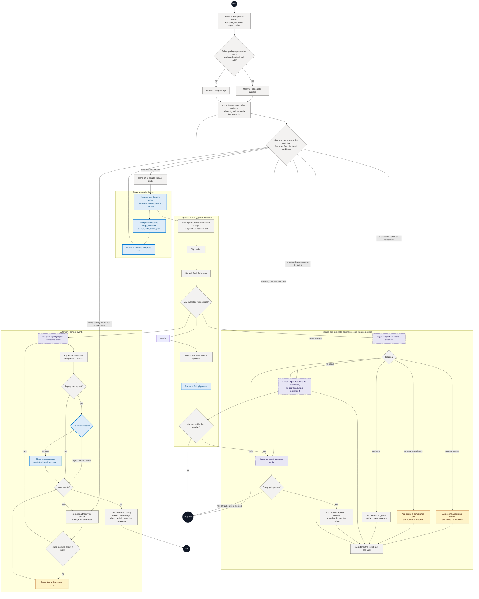
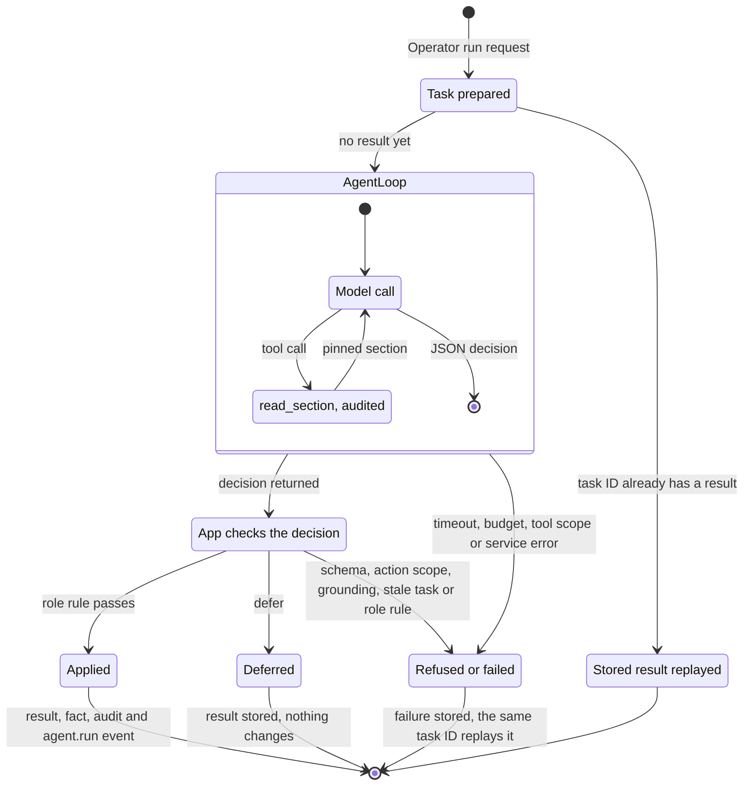
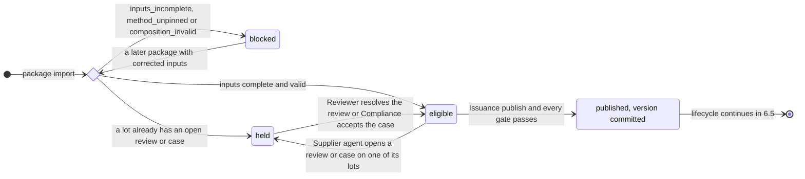
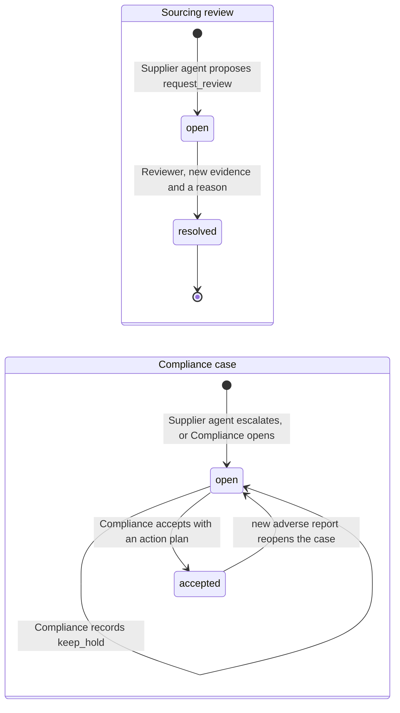
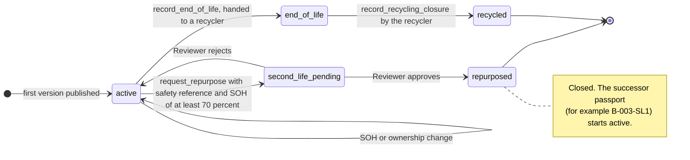
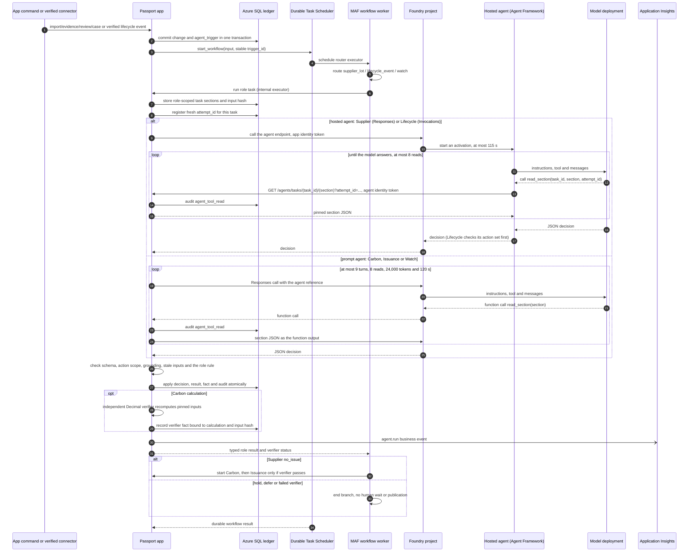
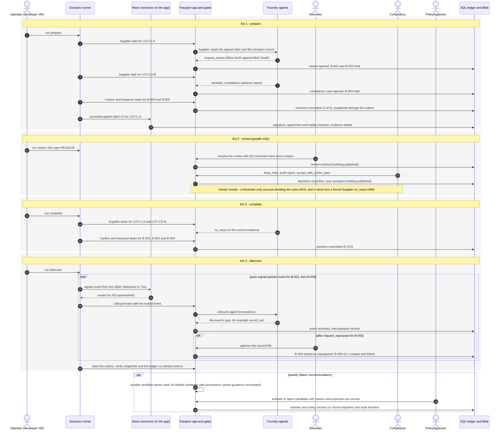
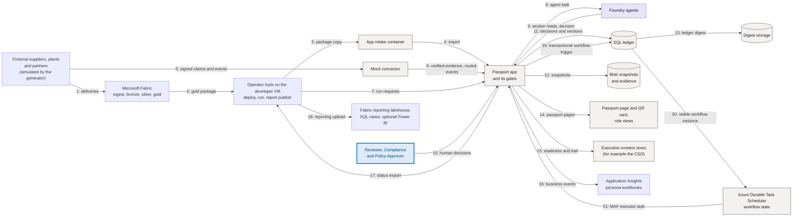

# Agents and process

This guide describes how the five AI agents run, how the application routes their work, and where people make decisions. It follows data from fictional suppliers to passport pages and executive screens. It documents the implemented MVP; [section 9](#9-limits-and-later-work) describes its limits and later work. For component and identity details, see the [architecture guide](architecture.md). The [scenario walkthrough](scenario-walkthrough.md) explains the story, and the [app reference](../app/README.md) describes the application rules.

All data in this guide is synthetic.

## 1. Summary

- **Agents propose, application gates control the process, and people make specified decisions.** No agent can publish independently, clear a hold, decide a compliance case, or approve a second life.
- **Deployed workflows are event-driven.** The app writes each trigger to its SQL outbox in the same transaction as the related change. The outbox worker dispatches a stable workflow ID to Azure Durable Task Scheduler. A Microsoft Agent Framework (MAF) workflow routes Supplier -> Carbon -> Issuance only when each preceding result passes its application-owned condition. Lifecycle events and weekly Watch runs use separate branches.
- **The scenario runner has a separate fixed planner** in `scenario/acts.py`. It is not a model. The planner builds the four-act evidence register and drives local scripted runs. The deployed workflow runtime is separate. Operators can still request explicit manual runs with `POST /agents/{role}/run`.
- **Two hosted agents use Microsoft Agent Framework:** Supplier and Lifecycle. Carbon, Issuance, and Watch are Foundry prompt agents. Agents do not call each other; the app and its workflow handle every hand-off.
- **Workflows do not wait for people.** A sourcing or compliance concern ends that branch. A human decision or new evidence creates a new supplier trigger. Watch guidance remains pending until the dedicated `Passport.PolicyApprover` activates a version.

## 2. Microsoft Agent Framework in the MVP

### 2.1 What runs where

The hosted agents share the source tree in [`agents/hosted/main.py`](../agents/hosted/main.py), selected by `AGENT_ROLE`. During stage B4, `deploy` packages it with [`requirements.txt`](../agents/hosted/requirements.txt) and copies of the app's `passport/domain.py` and `passport/agent_contracts.py`. This keeps the agent and app on the same contract.

| Part | Package | What it does in the MVP |
|---|---|---|
| `Agent` | `agent-framework-foundry` 1.16.2 | Uses role instructions from `agent_contracts.instructions(role)`, the `read_section` tool, and options `store: False` (no server-side conversation), `max_tokens: 2500`, and `max_tool_calls: 8`. |
| `FoundryChatClient` | `agent-framework-foundry` | Calls the role's model deployment (`AZURE_AI_MODEL_DEPLOYMENT_NAME`) in the Foundry project (`FOUNDRY_PROJECT_ENDPOINT`, injected by Foundry) with the agent's own Entra identity (`DefaultAzureCredential`). |
| `@tool read_section(task_id, section, attempt_id)` | `agent-framework-foundry` | The only tool. It checks the task and registered attempt IDs and that the section belongs to the role, gets a token for the app (`PASSPORT_APP_AUDIENCE`, `api://<app client ID>`) and reads `GET /agents/tasks/{task_id}/{section}?attempt_id=...` from the app's HTTPS Container Apps address (`PASSPORT_APP_URL`). It holds no database or storage credentials. |
| Activation deadline | Hosted runtime | Bounds an activation, including streaming and finalization, to 115 seconds while preserving the SDK response-stream contract. |
| `ResponsesHostServer` | `agent-framework-foundry-hosting` 1.0.0b261112 (preview) | Serves the **Supplier** agent over the OpenAI Responses protocol. |
| `InvocationAgentServerHost` | `azure-ai-agentserver-invocations` 1.3.0 | Serves the **Lifecycle** agent over the Invocations protocol. Its handler requires exactly `task_id` and `attempt_id`, runs the agent, refuses an action outside the Lifecycle set (`422`), and returns `decision` and `usage`. |

Foundry builds the hosted agents remotely (Python 3.14, 0.5 CPU, 1 GiB) and runs them in the `agents` subnet. Their identities hold only the app role `Passport.Agent.Supplier` or `Passport.Agent.Lifecycle`, and their client IDs are added to the app's sign-in allowlist.

The prompt agents are not Agent Framework code: each is a Foundry `PromptAgentDefinition` with the same role instructions and one `FunctionTool read_section` whose only parameter is the section name. The app itself answers those tool calls, so prompt agents need no identity of their own on the app.

### 2.2 Workflows and durable state

- `workflow_runtime.py` defines an executor graph and registers it with `DurableAIAgentWorker` in `isolated_v2` mode. The Container App's outbox worker starts named instances through `DurableWorkflowClient`. The stable trigger ID is also the workflow instance ID. If an outbox retry follows an uncertain start response, the app checks for that instance before acknowledging the trigger.
- Durable Task Scheduler holds orchestration state. Azure SQL holds the application outbox, tasks, results, facts, candidates, and active policy. A trigger is acknowledged only after the scheduler accepts it or the app finds the same instance. Agent steps use deterministic, context-derived task IDs and persist results in the ledger.
- The supplier branch proceeds to Carbon only after a successful `no_issue`. Carbon proceeds to Issuance only when its independent verifier fact is present. A defer, refusal, or failed gate stops the branch. Application gates remain authoritative, including for direct or manual API calls.
- Durable Task Scheduler is reachable only through its private endpoint in the `endpoints` subnet: public network access is disabled and the IP allowlist is empty. Entra managed identity authentication and the Durable Task Data Contributor assignment also protect operations. The scheduler dashboard works only from a browser on the developer VM.
- **No agent-to-agent messages, group chat, or shared memory.** Each activation runs one agent on one task and returns one JSON decision. Workflow edges pass the result to the next executor.
- **Agent memory and threads.** The app sets `store: False` and creates a fresh agent for each activation. An agent sees only the task's pinned sections, not earlier conversations.

## 3. How the five agents are invoked

### 3.1 Deployment creates the agents

`python -m dbp_mvp deploy` stage B4, on the developer VM with the operator's Azure CLI sign-in and the Foundry SDK (`azure-ai-projects`):

1. creates the Durable Task Scheduler and task hub (when agent mode is enabled), grants the app managed identity the built-in Durable Task Data Contributor role, and keeps at least one passport app replica running for the workflow worker (maximum 3);
2. checks Foundry's private access, the agents subnet and the model versions;
3. creates or updates `dbp-supplier` and `dbp-lifecycle` from code (`create_version_from_code`), waits until each version is active with its instance identity, gives that identity its app role and collects its client ID;
4. creates or updates `dbp-carbon`, `dbp-issuance` and `dbp-watch` as prompt agents (`create_version`);
5. writes each role's agent name, version, model and endpoint into `DBP_FOUNDRY_CONFIG_B64`, adds the hosted client IDs to the sign-in allowlist, sets the scheduler endpoint/task hub and redeploys the app with `DBP_AGENT_MODE=on`.

A new agent version is created only when the hosted source and settings, or a prompt agent's model, instructions and tool, change. Stage B7 calls the hosted Supplier agent through the app on `LOT-GR-A` and checks for its `agent.run` event in Application Insights.

### 3.2 The agents in the process

In deployed agent mode, application events start automatic workflows: package import, evidence upload, review resolution and accepted compliance cases enqueue Supplier triggers for affected critical lots that have a supplier claim (`supplier_claim` or `corrected_claim`). A transport record or adverse report that arrives before the claim is therefore assessed together with it, never alone. A verified connector event enqueues Lifecycle; the outbox worker persists one Watch trigger per ISO week. The scenario runner may also call `POST /agents/{role}/run` directly as an Operator, using its fixed planner.

| Process step | Agent and hosting | Started when | Reads | May propose | The app then | Autonomy label |
|---|---|---|---|---|---|---|
| Supplier due diligence, per critical lot (cobalt, lithium, nickel, graphite) | Supplier, hosted, Responses | Package import, evidence upload, review resolution, or accepted compliance case affects the lot | `evidence` (signed claim, transport record, adverse or audit report), `reviews` | `request_review`, `escalate_compliance`, `no_issue`, `defer` | Opens a sourcing review or compliance case, or records clearance bound to current evidence. Every answer cites lot evidence; a concern ends this branch. | L3: acts, escalates risk |
| Carbon footprint, per battery | Carbon, prompt | Successful Supplier `no_issue` routes to this step | `state`, `calculator` | `calculate`, `defer` | The app calculates with `illustrative-pcf-2`; an independent Decimal-based verifier records matching evidence. Synthetic results remain unassured. | L4: calculates only through gated code |
| Publication, per battery | Issuance, prompt | Carbon succeeded and a verifier fact is present | `state`, `gates` | `publish`, `defer` | Rechecks every gate, including verifier evidence, and commits the passport version or refuses with `409 publication_blocked`. | L4: gated publication |
| Lifecycle update, per routed partner event | Lifecycle, hosted, Invocations | The mock connector has verified and routed the signed event | `state`, `event` | The routed event's own type, `defer` | Applies it through the lifecycle state machine and commits a new version; a second life still waits for a Reviewer. | L4: autonomous within state rules |
| Regulatory watch | Watch, prompt | One persisted trigger per ISO week, dispatched by the app outbox worker | `sources`, `policy` | `recommend`, `defer` | Stores a pending, source-cited policy candidate. Only `Passport.PolicyApprover` can activate a new version. | L2: recommends |

The deployed workflow has a fixed order: Supplier `no_issue`, then Carbon calculation and verification, then Issuance. The app evaluates current state at each task. A hold or defer ends the branch; new evidence or a human decision creates a new trigger. Workflow routing does not authorize publication. The four-act runner uses its separate planner. Both use contract `dbp-agent-2` and base policy `synthetic-agent-policy-2` (`app/passport/agent_contracts.py`).

### 3.3 One activation, step by step

1. **Trigger.** The business transaction stores an `agent_trigger` in the SQL outbox. The worker dispatches its payload to the workflow with the trigger ID as stable instance ID; direct/manual `/agents/{role}/run` requests remain Operator-only.
2. **Prepare.** The workflow executor asks `AgentService` to build the role's sections from SQL, stores them with their hash as an `AgentTasks` row and audits `agent_task_prepared`. The context-derived task ID makes repeated triggers re-use the same result. Each actual invocation receives a fresh attempt ID.
3. **Screen** (Supplier only, `app/passport/prompt_shields.py`). Before the agent is invoked, the app sends every evidence document of the lot to the Prompt Shields `shieldPrompt` API of the Foundry account (Content Safety, API version 2024-09-01), with its managed identity. Long documents are split into overlapping pieces, at most five documents and 10,000 characters per call. If any document is flagged, the app opens a sourcing review as `system:prompt-shield` that names the flagged evidence, audits `prompt_attack_detected`, emits `hold.opened` and fails the task with `409 prompt_attack_detected`; no model reads the evidence. Once a Reviewer has resolved that review, the same evidence is let through (`prompt_attack_cleared_by_reviewer`). A clean screen is audited as `prompt_shield_passed`. A Content Safety error fails the task, so nothing unscreened reaches the model. The Foundry default content filter stays on the model deployments; unlike it, this gate screens each document separately and in full, and routes a detection to a person.
4. **Invoke** (`app/passport/foundry_runtime.py`), with the app's managed identity:
   - Supplier: the OpenAI Responses client against the hosted agent's endpoint in the Foundry project.
   - Lifecycle: an HTTPS `POST {"task_id", "attempt_id"}` to the hosted agent's Invocations endpoint.
   - Carbon, Issuance, Watch: the project's Responses API with a reference to the prompt agent's name and version. The app runs each `read_section` call itself and sends the result back, for at most nine turns.
5. **Read sections.** Hosted agents call `GET /agents/tasks/{task_id}/{section}?attempt_id=...` with their own token; prompt agents' calls are answered in the app. The app verifies the attempt was started, and counts the eight-read budget per attempt, not across retries. A section outside the role answers `403 tool_scope`, a ninth read `429 tool_budget`, and every read is audited as `agent_tool_read`.
6. **Check.** The answer must be the strict JSON decision (`action`, `reason` of 5-400 characters, at most 20 `evidence_ids`). Then: an action outside the role's set is refused with `403 action_scope`; an agent that did not read every section of its role with `422 grounding_required`; a task whose inputs changed while the agent worked with `409 stale_task`; then the role's own rule ([section 3.2](#32-the-agents-in-the-process)), for example `409 review_open` or `409 compliance_case_open` for a Supplier `no_issue` on a lot that people have not cleared.
7. **Apply and record.** The app applies the result in one SQL transaction: `AgentResults` (the response), `AgentFacts` (the accepted fact, bound to the hash of the inputs it used), the change itself (review, case, calculation, passport version or lifecycle event) and the audit row. Carbon also records a verifier fact; Issuance's gates require that fact to match the current calculation. Snapshots and new triggers use the outbox. Workflow-started runs now emit the same minimized `agent.run` telemetry as direct runs, and successful workflow publication emits `passport.published`; no prompts or evidence are sent.

The Issuance gates include: passport open; package/composition valid; no lot has an open review or case; every critical lot has current Supplier `no_issue` on its evidence; and a Carbon calculation **with a matching verifier fact** exists for current inputs. Only the application commits a version after all gates pass.

### 3.4 Budgets, replays and failures

| Limit | Hosted agents | Prompt agents |
|---|---|---|
| Time | 115 seconds in the agent, 120 seconds in the app | 120 seconds |
| Tool reads | 8 (agent option and app budget) | 8 |
| Output tokens per model call | 2,500 | 2,500 |
| Tokens per activation | not limited by the app | 24,000 reported tokens |
| Agent record | 8,000 encoded JSON bytes; evidence documents have a separate 16 KB limit | same |

- **Failures are recorded, never replaced.** Any error, timeout or refusal is stored as the task's result (`agent_execution_failed` is `502`); the app never substitutes a mocked or permissive answer.
- **Replays.** Reusing a task ID returns its stored result, including a failure. The scenario runner derives IDs from the series, role, subject, and observed state, including recorded results. After a recorded failure, a rerun can therefore create a fresh task without changing the evidence. Event-driven workflows instead use context-derived IDs, so unchanged workflow context can replay a failure.
- **No progress stops the act.** If an agent defers, or its answer does not change the state, the runner stops instead of retrying the same step.
- **Stuck work is observable.** Series snapshots count pending batteries with agent work older than 15 minutes; the executive workbook displays the count and an opt-in alert fires when it is nonzero. This is detection only: it does not automatically retry or release a battery.

### 3.5 Local runs without AI

`python -m dbp_mvp run local` and `run preview` use the same runner and app code in memory, with a scripted double in place of Foundry (`scenario/scripted.py`). The double reads every permitted section as a grounded agent would and applies one fixed rule per role. Its results carry `hosting: local_scripted_double` and `model: none (not AI)`. The local app acknowledges outbox workflow triggers but does not execute durable workflows; the acts invoke the scripted double directly. A local run exercises the planner, gates, and hand-offs, but does not verify model behavior or workflow hosting.

### 3.6 Model selection and request capacity

The five role assignments are centralized in [`agent_contracts.py`](../app/passport/agent_contracts.py). The model deployments in [`config.py`](../dbp_mvp/config.py), [`main.bicep`](../infra/main.bicep), and the [settings example](../config/mvp.example.toml) cover those assignments.

| Agent | Default model and pinned version | Workload fit |
|---|---|---|
| Supplier | `gpt-6.1-sol`, `2026-09-29` | Reconciles conflicting evidence and adverse findings, and provides cited explanations. |
| Carbon | `gpt-5.6-luna`, `2026-07-09` | A fast, compact model for a bounded calculate/defer choice. The application and independent verifier still perform all arithmetic. |
| Issuance | `gpt-5.6-luna`, `2026-07-09` | Reads the application's already-computed gates and explains publish/defer. A larger reasoning model cannot override or improve a failed deterministic gate. |
| Lifecycle | `gpt-5.6-luna`, `2026-07-09` | Bounded selection of a signed event's action or defer. The state machine and human second-life approval remain authoritative. |
| Watch | `gpt-5.6-terra`, `2026-07-09` | The balanced model for cited explanation and concise policy drafting; this role needs text generation, not just classification. |

[Microsoft's GPT-5.6 announcement](https://azure.microsoft.com/en-us/blog/gpt-5-6-now-available-in-microsoft-foundry/) positions Luna for high-volume, latency-sensitive work and Terra for balanced everyday workloads. Confirm model availability and quota for your region and subscription before deployment.

**GPT-6.2 Sol is not used.** With `gpt-6.2-sol` (`2026-11-17`) as the Supplier model, hosted Supplier activations failed. Through the Foundry project's Responses endpoint, which the hosted agent uses, the model returned server errors or completed responses with no output and zero token usage. The same deployment answered tool calls through the Foundry account's OpenAI endpoint, and the project endpoint served GPT-6.1 Sol and GPT-5.6 Luna normally. Before switching models, confirm that a tool-calling Responses request through the project endpoint returns output for the new model.

All three model deployments default to capacity **200**, corresponding to **200 requests/minute and 200,000 tokens/minute per deployment** for these model and SKU pairs. Confirm the effective limits in the target environment. Carbon, Issuance, and Lifecycle share Luna's allowance, and an activation can consume several model requests as it reads tools. This capacity does not guarantee unlimited throughput. The activation time, tool, and token budgets in section 3.4 also apply. Keep EU `DataZoneStandard`; do not silently substitute global processing or reduce capacity when quota is insufficient. See [applying model changes and checking effective limits](deployment.md#model-changes-and-rate-limits).

Ongoing evaluation and optimization should consider whether a decision model, such as [Microsoft-Decision-1.1](https://commandline.microsoft.com/microsoft-decision-model-ga/) or a MAI Decision model, is a better fit than a reasoning model for bounded classification or routing tasks. Confirm availability and API compatibility, then compare task accuracy, evidence and explanation requirements, latency, and cost before changing models. Validate through the Foundry project endpoint and the relevant hosted or prompt-agent path; a successful call through another endpoint does not establish compatibility. No decision model is currently integrated in the MVP. Application gates and human decisions remain authoritative.

## 4. Human in the loop

| Decision | Who | Where | What the agents cannot do |
|---|---|---|---|
| Resolve a sourcing review | `Passport.Reviewer` | Hold screen `/holds/{review_id}` or `POST /reviews/{id}/resolve`: new evidence, a reason and `expected_row_version` | The Supplier agent opens reviews but its `no_issue` is refused while one is open (`409 review_open`). |
| Decide a compliance case | `Passport.Compliance` | `/cases/{case_id}`: `keep_hold`, or `accept_with_action_plan` with an owner, a due date and new evidence | The Supplier agent escalates but has no decide action; `no_issue` is refused while the case is open (`409 compliance_case_open`); a Reviewer gets `403`. |
| Approve or reject a second life | `Passport.Reviewer` | "Second-life approvals" `/second-life/{id}`: decision, reason, `expected_row_version` | The Lifecycle agent records the repurpose request only; it and every other role get `403` on the decision. |
| Activate or reject Watch guidance | `Passport.PolicyApprover` | `/policy`: review the cited candidate, labeled "AI-drafted" with model, version, and task, then activate or reject it with a reason and its `expected_row_version` | Watch can only recommend. A rejection leaves the active guidance unchanged. The approved guidance is versioned context; it cannot change the app's code-owned publication, safety, or compliance gates. The role is declared but not assigned automatically. |
| Run the acts | `Passport.Operator` | `python -m dbp_mvp run story` chains the acts and waits while people decide in the app; it never decides itself. `run ...` plays one act; the review act asks you to type `RESOLVE` before it records your Reviewer and Compliance decisions | Local scripted runs are not AI. Deployed event triggers can run alongside acts; human roles still decide holds and cases. |

Each human decision is recorded in the ledger with the actor and reason. The decision trail (`/trail/{id}`) displays AI proposals with the label "AI proposal," alongside human decisions and gate results. Each non-empty agent text field (`reason`, `policy_title`, or `policy_text`) also receives an application-level provenance record and an "AI-generated" or "AI-drafted" label in the views that display it. An agent's reason for opening a review remains separate from the Reviewer's resolution reason. See [AI and the EU AI Act](eu-ai-act.md#4-how-ai-text-is-marked-and-detected-art-502) for the marking implementation. The [autonomy and human oversight](eu-ai-act.md#2-autonomy-and-human-oversight) section explains the autonomy labels, why specified decisions remain with people, and the residual risk of unattended publication.

## 5. Activity diagram: the acts and deployed trigger path

This Mermaid flowchart uses UML activity notation. The upper path shows the scenario acts and their fixed planner; the lower path shows deployed, event-triggered orchestration. Rounded boxes represent actions, diamonds represent decisions, and filled circles mark the start and end. Colors and outlines follow the app's decision-trail key and are intended to remain distinguishable for readers with color-vision deficiencies: charcoal represents the application, indigo with a dashed outline represents an AI agent, blue with a heavy outline represents a person, and amber represents a hold.

In the scenario the main series follows this path: prepare publishes B-003 and B-005 (2 of 5) and holds B-001, B-002 (sourcing review on `LOT-LI-A`) and B-004 (compliance case on `LOT-CO-B`); review records the human decisions and publishes nothing; complete publishes the other three (5 of 5); aftercare repurposes B-003 as `B-003-SL1` and recycles B-005.

## 6. State machine diagrams

### 6.1 Event-triggered workflow and scenario runner

The deployed MAF workflow is event-driven and durable; the scenario runner's fixed planner remains a separate harness for the four-act evidence register. A concern ends its workflow branch, while new evidence or a human decision creates a new trigger.

```mermaid
stateDiagram-v2
    direction TB
    state "Application event committed" as Event
    state "SQL outbox trigger" as Outbox
    state "Durable Task Scheduler instance" as Scheduled
    state route <<choice>>
    state "Supplier agent" as Supplier
    state "Carbon agent and independent verifier" as Carbon
    state verify <<choice>>
    state "Issuance agent and application gates" as Issuance
    state "Lifecycle agent" as Lifecycle
    state "Watch agent" as Watch
    state "Pending Watch candidate" as Candidate
    state "Human review" as People
    state "Workflow branch complete" as Done

    [*] --> Event
    Event --> Outbox: same SQL transaction
    Outbox --> Scheduled: stable trigger ID
    Scheduled --> route
    route --> Supplier: supplier_lot
    route --> Lifecycle: lifecycle_event
    route --> Watch: weekly watch
    Supplier --> Carbon: status 200 and no_issue
    Supplier --> People: review, escalation or defer
    Carbon --> verify
    verify --> Issuance: verifier fact matches
    verify --> Done: mismatch or failed task
    Issuance --> Done: gate passes and version committed
    Issuance --> Done: gate fails or agent defers
    Lifecycle --> Done: state-machine result recorded
    Watch --> Candidate: recommendation with source IDs
    Candidate --> People: PolicyApprover activates or rejects AI-drafted version
    People --> Event: new evidence / review resolution / case accepted
    People --> Done: decision recorded; no automatic waiver

    note right of People
        Sourcing Reviewer,
        Compliance and PolicyApprover
        use separate app routes.
        No workflow waits for them.
    end note
```

### 6.2 One agent activation

The life of one task inside the app. The inner states are the agent's own loop: Agent Framework's `Agent` in the hosted agents, Foundry's prompt agent runtime with tool calls answered by the app for the others.

### 6.3 Battery publication status

The result the app gives each imported battery ([app reference, section 2](../app/README.md#2-the-three-rules)). People move a battery out of `held`; only the Issuance path moves it to published.

A committed version is never withdrawn. If a later package or case holds a published battery, its last version stays public and the next version waits.

### 6.4 Sourcing reviews and compliance cases

While a review or case is open, every battery using the lot is `held`. Resolving or accepting publishes nothing: the Supplier agent reassesses the lot on the new evidence, then the gates decide.

### 6.5 Passport lifecycle

The only place that applies lifecycle events is `app/passport/lifecycle.py` ([app reference, section 2.2](../app/README.md#22-lifecycle-and-second-life)). Each recorded event commits a new passport version; an event that is not allowed now is quarantined with a reason code and never applied.

## 7. Sequence diagrams

### 7.1 One agent activation

The deployed Supplier path, starting at an application event and durable workflow; prompt-agent calls are shown as the alternative.

### 7.2 Hold, human decisions, publication and aftercare

The four-act command-line scenario end to end. Section reads are left out; they follow 7.1. The scenario runner may call agent endpoints directly for its evidence register; deployed event triggers enter through the outbox and MAF workflow as shown in 7.1. In the scenario the operator holds the Reviewer, Compliance and Connector roles, and the runner delivers the messages the fictional parties signed.

## 8. Communication diagram: from supplier to executive screens

This Mermaid flowchart uses UML communication notation. Boxes represent participating components, arrows represent links, and each message has a sequence number. The table below explains the messages.

| No. | From -> to | Message | Contract and checks |
|---|---|---|---|
| 1 | Parties -> Fabric | Each party's synthetic deliveries (JSON or CSV, mixed units), uploaded to the `ingest` lakehouse by `deploy` B5; `supply_flow` builds bronze, silver and gold. | Shared rules in `data/pipeline/`; a rejected delivery is recorded with a reason and loads nothing. |
| 2 | Fabric -> tools | The gold passport package. | Independent check (`data/package.py`); data files must match the local build byte for byte, otherwise the local package is used. |
| 3 | Tools -> intake | The package copied to `intake/<build>/` (B6). | Contract `dbp-passport-package-2`, manifest written last. |
| 4 | Intake -> app | Import of every battery, lot and composition row. | The app's own package check; each battery becomes blocked, held or eligible. |
| 5 | Parties -> connector | Ed25519-signed supplier claims and partner lifecycle events, delivered by `deploy` B6 and the acts. | Agreement, signature, key owner, audience, validity, revocation, permitted lot or event type, replay. |
| 6 | Connector -> app | Verified claims become lot evidence; allowed lifecycle events are routed, others quarantined. | Message log in the ledger (`ConnectorMessages`). |
| 7 | Tools -> app | Explicit/manual `POST /agents/{role}/run` and the act's other requests, with the operator's token. | `Passport.Operator`, agent mode on, idempotent task IDs. Automatic agent triggers use messages 19-21. |
| 8 | App -> Foundry | One workflow executor's agent task: Responses or Invocations call to a hosted agent, or a Responses call to a prompt agent. | App managed identity; the endpoint must belong to the configured project and agent. |
| 9 | Foundry -> app | Section reads (`read_section`) and the JSON decision. | Role-scoped sections, registered task/attempt pair, eight reads per attempt, strict decision schema. |
| 10 | People -> app | Review resolution, compliance decisions, second-life approval or Watch guidance activation. | Dedicated app roles, reason, new evidence where required, `expected_row_version`; policy activation cannot change code-owned gates. |
| 11 | App -> SQL | Decisions, passport versions, facts, events and audit in ledger tables. | One SQL transaction per decision; append-only tables refuse updates and deletes. |
| 12 | App -> Blob | Passport snapshots through the outbox, plus evidence files. | Snapshot hash recorded in SQL, Blob versioning on. |
| 13 | SQL -> digest storage | Database ledger digest (`ledger anchor`, run on the developer VM). | Verified by `ledger verify`, the trail screen and aftercare. |
| 14 | App -> passport pages | `/p/{id}` and the printable QR card for everyone; `/passports/{id}/view` per viewer role. | Field policy per role; a held battery shows only "Not yet issued". |
| 15 | App -> executive screens | `/exec` passport readiness with the four success measures and per-plant table, hold, case and second-life screens, decision trail. | Staff sign-in; synthetic and illustrative labels. |
| 16 | App -> Application Insights | Allowlisted business events such as `agent.run`, `passport.published` and `passport.series.snapshot`, read by the four persona workbooks. | No evidence content, free-text reasons, prompts, user names or tokens. |
| 17 | App -> tools | Reporting export v2 (`GET /report/status`) read by `report publish`. | Minimized: status, versions, dates and lot-claim status, no people or evidence. |
| 18 | Tools -> reporting | Upload to the `reporting` lakehouse; `status_flow` computes the measures, the SQL endpoint views and the optional Power BI report read them. | Schema version 2, file hashes, column contract; same measure definition as the app. |
| 19 | App -> SQL | Business transaction writes an agent trigger to the durable outbox. | Same transaction as the package/evidence/review/case/lifecycle event; stable trigger ID. |
| 20 | SQL -> Durable Task Scheduler | Start a durable workflow instance with that stable ID. | App managed identity has Durable Task Data Contributor; the scheduler is reachable only through its private endpoint. |
| 21 | Scheduler -> app | Dispatch the router and role executors to the always-on Container App worker. | MAF workflow graph; Supplier -> Carbon -> Issuance only on success and verifier evidence, with separate Lifecycle and Watch branches. |

## 9. Limits and later work

- **Workflow deployment.** Validate scheduler provisioning, private endpoint connectivity, workflow execution and recovery, and Lifecycle callbacks in the target Azure environment. Bicep compilation does not prove runtime connectivity. `agent-framework-foundry-hosting` is a preview package.
- **Workflow semantics.** Durable orchestration does not persist human approval waits; human review is completed on the app, and the resulting application event creates another workflow. Workflow state is in the scheduler, while business state and audit remain in SQL. The scenario runner and direct Operator endpoint remain alternate entry points.
- **Carbon assurance.** The verifier independently repeats arithmetic against the same pinned factor set; it proves calculation consistency, not factor-source quality, measurement accuracy or emissions assurance. Records remain synthetic and illustrative.
- **Policy scope.** An approved Watch candidate changes the guidance displayed on `/policy` and the baseline read by Watch. Other agents' section tools do not expose that guidance, and it cannot change code-owned legal, compliance, or publication gates. Review proposed guidance for attempts to widen agent behavior.
- **Model quality and cost.** Accuracy, latency, and total cost depend on the workload. Evaluate them with representative cases before use.
- **Application-level provenance.** The app records and labels agent-generated text. Matching uses normalized copies, not paraphrased or translated text.
