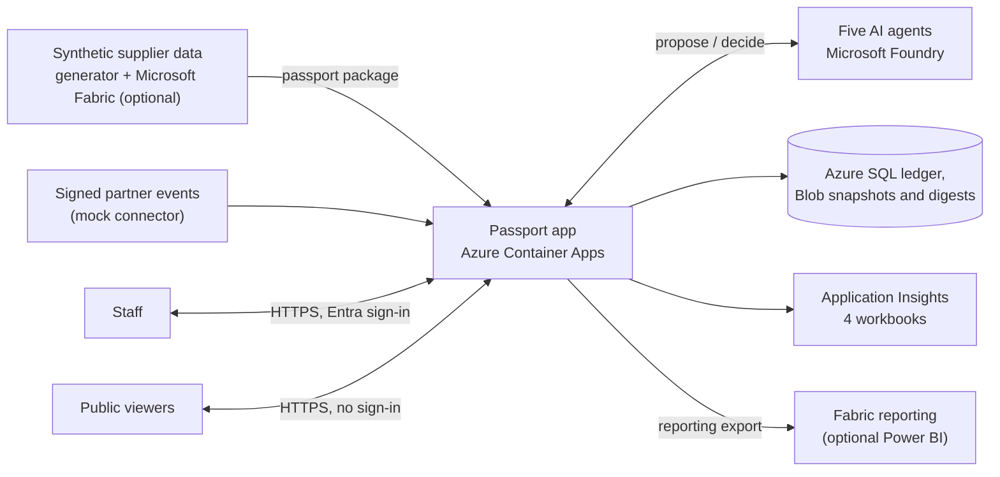
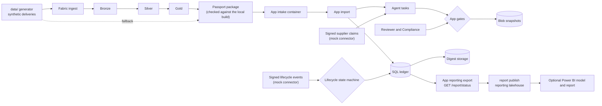
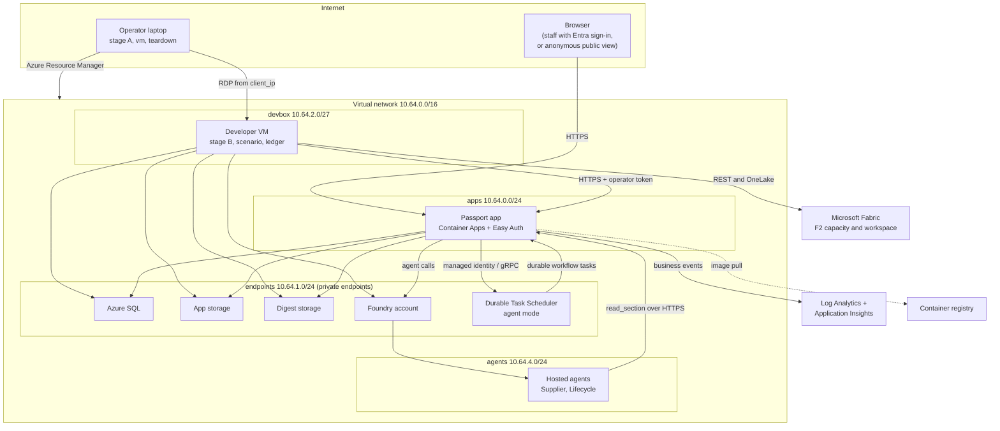

# Architecture

This guide describes how the synthetic battery passport MVP prepares supplier data, creates passport records, and tracks lifecycle events. AI agents propose actions within code-enforced boundaries, and people make specified decisions. The design is not a production or compliance architecture.

Use synthetic data only. The MVP is not built to protect real personal or commercial data; see the [security policy](../SECURITY.md).

Start with the overview in section 1. For deployment steps and settings, see the [deployment guide](deployment.md). The [app reference](../app/README.md) describes the app's rules, roles, and endpoints. The [security and responsible AI threat model](threat-model.md) covers trust boundaries, controls, compliance mappings, and production gaps.

## 1. Architecture at a glance

The **passport app** imports a package of synthetic supplier data, evaluates it against application rules, and records the outcome. Five AI agents support distinct steps of the process in agent mode. They propose actions but cannot override the app's gates. People resolve sourcing reviews and compliance cases, approve a second life, and activate Watch guidance.

Decision records use tamper-evident Azure SQL ledger tables. SQL, storage, the Foundry account and, in agent mode, Durable Task Scheduler use private endpoints. The app, container registry and monitoring endpoints are public by design.

| Component | What it does | Azure service | Details |
|---|---|---|---|
| Passport app | Imports passport packages, calculates the illustrative carbon footprint, enforces the gates and lifecycle state machine, records decisions, and serves the operations console and public passport pages. | Azure Container Apps with Easy Auth (Microsoft Entra ID) | [3.1](#31-passport-app) |
| Ledger and evidence | Stores tamper-evident decision records, versioned passport snapshots, and separately stored ledger digests. | Azure SQL Database ledger tables, Blob storage | [3.2](#32-azure-sql-database-and-ledger-digests) |
| Agents | Five AI agents (Supplier, Carbon, Issuance, Lifecycle, and Watch) propose actions. A durable workflow routes them. | Microsoft Foundry (hosted and prompt agents), Durable Task Scheduler | [3.3](#33-microsoft-foundry) |
| Data preparation and reporting | Builds the passport package from synthetic deliveries and publishes the status export. | Microsoft Fabric (F2), optional Power BI | [3.4](#34-microsoft-fabric) |
| Monitoring | Records business events and provides four persona workbooks and three log alert rules, which are off by default. | Log Analytics, Application Insights | [3.5](#35-monitoring) |
| Developer VM and tool | Runs operator commands and the scenario inside the network. The VM is not on the app's runtime path. | Azure virtual machine, `python -m dbp_mvp` | [3.6](#36-developer-vm) |

### 1.1 Design principles

- **Agents propose; application rules decide.** Each agent has a bounded role, reads only sections permitted for that role, and may request one action from its role's list. The app's gates and state machine decide whether to apply it ([agents and process](agents-and-process.md), [EU AI Act](eu-ai-act.md)).
- **People make specified decisions.** Sourcing reviews, compliance cases, second-life approval, and activation of Watch guidance stay with named human roles. No agent identity holds those roles.
- **Private data plane.** SQL, both storage accounts, and the Foundry account have public network access disabled. Operator work runs from a developer VM inside the network. Other services have public endpoints ([section 2](#2-network-and-trust-boundaries)).
- **Microsoft Entra identities.** Staff, the operator, the app, and the hosted agents have their own identities and scoped roles ([section 4](#4-identities-and-permissions)). SQL accepts Entra authentication only, and the MVP does not use SQL passwords or storage keys.
- **Checkable evidence.** SQL ledger tables, versioned Blob snapshots, and ledger digests in a separate storage account help detect tampering. The app records each snapshot's hash and Blob version ID and writes snapshots without overwriting them. The passport container has no locked immutability policy. The app also records provenance for accepted agent text.
- **Reproducible packages with a Fabric fallback.** The generator normally reuses the saved build for a series and size. If the Fabric package build fails or differs from the local build, the local package is used. This fallback does not replace Fabric reporting or remove deployment prerequisites when Fabric is enabled.

### 1.2 How a passport comes to life

1. **Prepare.** Build a passport package from fictional suppliers' deliveries, using Microsoft Fabric or the local fallback, and import it into the app. Deliver signed supplier claims separately through the mock connector.
2. **Assess.** The app calculates each battery's illustrative carbon footprint and marks it blocked, held, or eligible. A held battery has an open sourcing review or compliance case.
3. **Check.** In agent mode, a durable workflow runs Supplier, Carbon, and Issuance in that order. Supplier can open a review or compliance case when evidence conflicts or shows adverse risk.
4. **Decide.** People resolve holds. New evidence and human decisions trigger new checks.
5. **Publish.** In agent mode, Issuance requests publication and the app publishes only when every gate passes. A committed passport version is never overwritten.
6. **Follow the life.** Signed partner events pass through the mock connector and lifecycle state machine. Only a human Reviewer can approve a second life. Separately, Watch recommends regulatory guidance that a `Passport.PolicyApprover` may activate.

The following diagram summarizes the flow. Fabric can be omitted for package preparation. For reporting, `report publish` retrieves the app's reporting export and sends it to the Fabric reporting lakehouse.

The following sections cover [network and trust boundaries](#2-network-and-trust-boundaries), [components](#3-components), [identities and permissions](#4-identities-and-permissions), [data flow details](#5-data-flow), and [limitations](#6-what-this-architecture-does-not-cover).

## 2. Network and trust boundaries

Deployment has two stages. **Stage A** (`bootstrap`) runs on your laptop and uses Azure Resource Manager to create the infrastructure. Its preflight also checks Microsoft Graph and, when Fabric is enabled, the Fabric API. **Stage B** (`deploy`) runs on the developer VM inside the network and configures the environment. The [deployment guide](deployment.md#overview-two-stages) lists what each stage creates.

The stages are separate because SQL, the storage accounts, and the Foundry account have public network access disabled. Stage B and the scenario reach them from the VM using the operator's Azure CLI account. The app does not use SQL passwords or storage keys. Staff sign-in uses an app registration whose client secret is stored as a Container Apps secret ([section 4](#4-identities-and-permissions)).

The diagram shows the network topology and connections.

### 2.1 Subnets and private DNS

| Subnet | Range | Purpose |
|---|---|---|
| `apps` | 10.64.0.0/24 | Delegated subnet for the Container Apps environment. The app's ingress is external HTTPS. |
| `endpoints` | 10.64.1.0/24 | Private endpoints for SQL, both storage accounts, the Foundry account and, in agent mode, Durable Task Scheduler. |
| `devbox` | 10.64.2.0/27 | Developer VM. Its network security group allows Remote Desktop Protocol (RDP) only from `client_ip` (`vm_access = "source-ip"`), or opens it on request through Defender for Cloud just-in-time access (`vm_access = "jit"`). |
| `agents` | 10.64.4.0/24 | Delegated subnet for the Foundry agent capability host, where the hosted agents run. An optional NAT gateway provides a fixed outbound address. |

Private DNS zones resolve the private endpoints inside the network: `privatelink.blob.core.windows.net`, `privatelink.database.windows.net`, `privatelink.services.ai.azure.com`, `privatelink.openai.azure.com`, `privatelink.cognitiveservices.azure.com` and, in agent mode, `privatelink.durabletask.io`. Stage B checks (B7) confirm that the SQL, storage and Foundry host names resolve to private addresses and that every private endpoint is approved.

**Public surfaces by design:** The passport app provides public passport pages, as a QR code on a battery might require. The VM's RDP port is restricted to the configured client address or just-in-time access. Fabric is reached over its public APIs. The following are accepted risks for this synthetic-data MVP; a production deployment should close them:

- **Container registry.** ACR is public: ACR Tasks builds the image, the admin user is disabled, and the app pulls with its managed identity. A private registry needs the Premium tier, a private endpoint and a build agent inside the network.
- **Monitoring endpoints.** Log Analytics and Application Insights accept ingestion and queries from public networks, so the workbooks open in the Azure portal from any signed-in browser. Azure Monitor Private Link Scope would close this.
- **Application Insights local authentication.** Ingestion accepts the connection string without a Microsoft Entra token. Anyone who obtains the connection string can send fabricated telemetry, but cannot read it. Entra-only ingestion would require every telemetry sender, including the app and the Foundry agents, to send with a Microsoft Entra credential.

Durable Task Scheduler has public network access disabled and an empty IP allowlist; the app reaches it through its private endpoint. Its dashboard therefore works only from a browser on the developer VM.

### 2.2 Trust boundaries

| Boundary | How it is protected |
|---|---|
| Browser to app | HTTPS. Staff sign in with Microsoft Entra ID through Easy Auth and receive app roles; public passport pages need no sign-in. |
| Operator laptop to Azure | Azure Resource Manager creates the infrastructure. Preflight also uses Microsoft Graph and, when enabled, the Fabric API. RDP to the VM is restricted to `client_ip` or just-in-time access. |
| Developer VM to the data plane | Private endpoints inside the network and the operator's Azure CLI account. |
| App to SQL, storage, and Foundry | Private endpoints and the app's managed identity, with scoped roles and per-table database grants ([section 4](#4-identities-and-permissions)). |
| Hosted agents to app | `read_section` calls over HTTPS with separate Entra identities. Each identity holds one app role and is on the app's sign-in allowlist. |
| Partners to app | The mock connector checks the party's signature, agreements, party registry, and replay status. Trust comes from those checks, not from the caller. |
| App and Durable Task Scheduler | A private endpoint with public network access disabled. Calls also require the app's managed identity and its task-hub role. |
| App to Application Insights | Allowlisted business events only. Evidence content, free-text reasons, prompts, user names, email addresses, and tokens are excluded. |

## 3. Components

### 3.1 Passport app

The FastAPI passport app in Azure Container Apps uses 1 vCPU and 2 GiB per replica and can scale to 3 replicas. It can scale to zero only when agent mode is off and `warm_replica` is false. Container Apps authentication (Easy Auth) signs staff in with Microsoft Entra ID; public passport pages need no sign-in. The app:

- Imports passport packages and evidence from its intake storage container. Its own code checks contract `dbp-passport-package-2`.
- Calculates each battery's illustrative carbon footprint per kWh using method `illustrative-pcf-2`, a bundled copy of the illustrative factor set, and the plant's grid factor.
- Marks each imported battery blocked (`inputs_incomplete`, `method_unpinned`, or `composition_invalid`), held because a lot has an open sourcing review or compliance case, or eligible. A human Reviewer must resolve a review, or a Compliance user must accept a case with an action plan and new evidence, before the corresponding hold ends.
- Never overwrites a committed passport version. In agent mode, publication follows the gated Supplier, Carbon, and Issuance path.
- Records decisions in Azure SQL ledger tables and writes passport snapshots to Blob storage through an outbox without overwriting them.
- Applies signed lifecycle events through its state machine, including state of health, ownership change, repurpose request, end of life, and recycling closure. Each applied event commits a new passport version; an event that is not allowed is quarantined with a coded reason. Only a human Reviewer can approve a second life, which closes the original passport and creates a linked successor.
- Writes event triggers transactionally to the SQL outbox. An outbox worker dispatches stable workflow instances to Durable Task Scheduler, and the Microsoft Agent Framework worker routes the five Foundry agents.
- Checks each structured answer and the independent Carbon verifier against the role's allowed actions and the publication gates.
- Serves the operations console and executive screens, including readiness, the public passport and card, hold review, decision trail, and Settings.
- Emits allowlisted business events to Application Insights, including workflow agent runs and a count of pending agent work older than 15 minutes for each series.

See the [app reference](../app/README.md) for details.

### 3.2 Azure SQL Database and ledger digests

The deployment uses one paid General Purpose serverless database on Standard-series (Gen5) hardware, with a minimum of 0.5 vCores and a maximum of 2. Authentication is Microsoft Entra-only. The operator is the server administrator. The app's managed identity is a database user with per-table grants generated from the app's table manifest: `SELECT, INSERT` on append-only tables and `SELECT, INSERT, UPDATE` on the others. It has no `DELETE` or data definition language (DDL) rights and no access to the `report` schema.

Decision tables, tasks, results, policy candidates, and active Watch guidance use SQL ledger tables. The SQL outbox stores snapshot writes and workflow triggers.

Server auditing sends sign-ins and permission, principal, role membership and schema changes to Log Analytics (table `AzureDiagnostics`, category `SQLSecurityAuditEvents`, 30-day retention). Statement auditing is left out because the app's worker polls every few seconds; the ledger tables record data changes. The diagnostic setting that routes these events uses API version `2021-05-01-preview` because the stable version cannot target the server's `master` database. The Foundry account's diagnostic setting uses the same version; diagnostic settings are the MVP's only preview API version.

`dbp.SchemaInfo` records schema version 4, including the aftersales records. `schema.sql` refuses a database of another version, and the app reports `schema_mismatch` and refuses writes. A schema change requires deliberate database recreation, which deletes existing application data. Compare [`data reset` and `data clean`](deployment.md#61-choose-a-fresh-run-a-new-build-or-a-database-rebuild) before choosing a procedure.

`ledger anchor` stores a database digest in a separate storage account under `manual/<server>/<database>/<incarnation>/`, where the incarnation is the database's creation time. The container has an unlocked immutability policy. `ledger verify`, the app, and the scenario's aftercare check the ledger against those digests. See [ledger verification](../app/README.md#51-ledger-verification).

### 3.3 Microsoft Foundry

The deployment has one Foundry account with public access disabled, one project named `passport`, three model deployments, and five agents:

| Agent | Kind | Default model | May propose | Reads |
|---|---|---|---|---|
| Supplier | Hosted | `gpt-6.1-sol` | Request a review, escalate to Compliance, no issue, defer | evidence, reviews |
| Carbon | Prompt | `gpt-5.6-luna` | Calculate, defer | state, calculator inputs |
| Issuance | Prompt | `gpt-5.6-luna` | Publish, defer | state, gates |
| Lifecycle | Hosted | `gpt-5.6-luna` | Record the routed lifecycle event (state of health, ownership change, repurpose request, end of life, recycling closure), defer | state, event |
| Watch (regulatory watch) | Prompt | `gpt-5.6-terra` | Recommend, defer | sources, policy |

All three deployments default to `DataZoneStandard` with capacity `200`. For these model versions, that corresponds to 200 requests per minute (RPM) and 200,000 tokens per minute (TPM) per deployment. Carbon, Issuance, and Lifecycle share Luna's allowance. Check the effective limits in the deployment. The [model selection and capacity rationale](agents-and-process.md#36-model-selection-and-request-capacity) discusses workload fit, evaluation limits, and possible future use of decision models.

Agents use one `read_section` tool to read their role's task sections. The app checks the role, section, and registered task/attempt pair, with at most eight reads per attempt. Agent records are limited to 8,000 encoded JSON bytes. Agents are instructed to treat evidence as untrusted data and return a small JSON decision. The app's gates decide whether to apply an action. **No agent can resolve a hold, decide a compliance case, or approve a second life.**

The hosted agents run in the `agents` subnet with their own Entra identities. Each identity holds only the app role `Passport.Agent.Supplier` or `Passport.Agent.Lifecycle`, and its client ID is added to the app's sign-in allowlist. The hosted agents use Microsoft Agent Framework; the prompt agents are Foundry prompt agent definitions. Stage B creates or updates the agents and records their versions.

The [agents and process guide](agents-and-process.md) explains agent invocation, human decisions, and what is not built yet. It also provides activity, state machine, sequence, and communication diagrams.

The agent contract is `dbp-agent-2` with policy `synthetic-agent-policy-2` (`app/passport/agent_contracts.py`). Each agent's instructions contain a short common preamble and its role's limits:

- Supplier runs only for critical-material lots (cobalt, lithium, nickel, graphite). It reads the signed claim and any transport record, adverse report, or audit report. It can open a sourcing review for a provenance conflict or escalate a compliance case for an adverse report without a later audit. An audit that answers the report is for Compliance, not a reason for a review. Supplier cannot clear or decide either.
- Carbon requests the calculator with the pinned method and factor set; it does no arithmetic.
- Issuance proposes publication only when every gate passes: valid composition, pinned method, current calculation, cleared critical lots, no open review or compliance case, and passport not closed.
- Lifecycle proposes an action for a verified connector event only when the passport's state allows it; otherwise it returns `defer`. The app applies only what the state machine allows. The agent cannot approve or reject a second life.
- Watch recommends guidance. Its recommendations remain candidates until the separately assigned `Passport.PolicyApprover` activates or rejects them. Approved guidance cannot alter code-owned gates.

The app refuses an action outside the role's set with `403 action_scope`; the hosted Lifecycle agent also refuses one before answering (`422`). Separate Decimal arithmetic checks Carbon's result and records a verifier fact. Issuance requires a matching fact before publication.

Accepted agent text fields receive an append-only `AiContentProvenance` record and labels on relevant APIs and screens. A validation error can quote rejected model output without a mark. The [AI and the EU AI Act guide](eu-ai-act.md) describes the provenance method and its limits.

In agent mode, the durable workflow routes Supplier to Carbon and then Issuance on success. It routes verified Lifecycle events and weekly Watch triggers separately. New evidence and human decisions create new supplier triggers once the lot has a supplier claim. Changing agent instructions changes their fingerprint, so the next `deploy` creates new agent versions.

### 3.4 Microsoft Fabric

By default, the deployment includes an F2 capacity and a workspace named `<prefix>-passport` with five lakehouses: `ingest`, `bronze`, `silver`, `gold`, and `reporting`. With `deploy_fabric = false`, the package is built locally.

The tool attempts to pause the capacity after deployment and after Fabric work, including after a failure. A failed pause can leave the capacity active and billable.

**Package build (stage B):**

- Stage B uploads every party's synthetic delivery to `ingest`, with each delivery's `delivery.json` last. It runs the `supply_flow` pipeline, whose notebooks `bronze_load`, `silver_normalise`, and `gold_package` run the shared rules embedded with their hash. `bronze_load` records a rejected delivery in the bronze `deliveries` table with a coded reason and loads none of its records.
- Stage B fetches the gold package, checks it independently, and compares it with a local build. Data files must match byte for byte; the manifest must match apart from its completion time. If the Fabric build fails or the packages differ, the local package is used.

**OEM aftersales:**

The OEM aftersales path is separate from both the production package and the reporting export. `aftersales_flow` lands service, battery-management and quality deliveries in ingest, records raw source data in Bronze, validates and deduplicates in Silver, and produces a versioned per-series Gold package. The VM transfers Fabric's output to app intake. The app verifies the package and imports it into SQL. Customer views read SQL, not a live lakehouse, so pausing Fabric does not take down the passport app. A failed Fabric run must not be replaced by local service or recall data in Azure.

`Passport.OEM` identifies the persona. Exactly one additional fleet role in the Entra sign-in identifies the customer for aftersales. Pack membership in the imported feed, not the current holder or a browser series filter, limits access to warranty details and recall counts. No user IDs or role assignments are stored in deployment configuration. Production decisions, passport snapshots, Foundry roles, report export v2, and the Power BI model stay separate.

**Reporting (`report publish`):**

- `report publish` reads the app's reporting export v2 from `GET /report/status`. The export includes schema version 2, the app's export ID, passport rows, and lot-claim rows. The command uploads the export under that ID to the reporting lakehouse: `passport_status.jsonl` with the app's passport row columns in order, `lot_claims.jsonl`, and finally `manifest.json` with both files' SHA-256 hashes and row counts.
- The `status_flow` pipeline and its `reporting_measures` notebook refuse an export with schema version 1, a missing file, a changed hash, other columns, a field outside the contract (people, evidence, file names, prompts), or a battery that is not in a completed package. Rerunning the same export ID replaces its rows. The pipeline writes `passport_status_history`/`_current`, `lot_claim_status_history`/`_current`, and the measure tables `success_measures`, `measures_by_plant`, and `supplier_completeness`, each stamped with the export ID and generation time.
- The four success measures are passport coverage, verified footprint per kWh, supplier data completeness, and second life. For the footprint measure, "verified" means a published battery has at least one critical lot and all its critical-lot claims have been verified. It does not mean the footprint or its inputs have independent assurance or regulatory certification. The measures are defined in `data/metrics.py`, which the notebook embeds and uses to compute them from export rows and lot claims. A test compares the values with the app's executive screen and `passport.series.snapshot` event for the story series. Batteries in a completed package that are missing from the export are counted in `not_in_export`.
- The SQL analytics endpoint provides five views: `v_passport_status_current` (with `is_issued`), `v_lot_claim_status`, `v_measures_by_plant` (with an `ALL` row), `v_supplier_completeness`, and `v_success_measures`.

**Optional Power BI:** Enabling `powerbi` adds the Direct Lake semantic model `passport-measures` on the five reporting tables and a six-page chief sustainability officer (CSO) report: Executive overview, Market readiness, Supplier assurance, Footprint and content, Circular value, and Trust and gaps. Its shared 1600 x 900 design uses decision-led headlines, navigation, four key performance indicators (KPIs), and two supporting views. Every business visual is labeled synthetic or illustrative. Missing data stays blank or "Not measured", not a fabricated zero. Recycled shares are unweighted averages, and successor records never inflate original production.

**Independent CFO report:** `fabric/powerbi/finance-synthetic.pbip` opens a separate six-page chief financial officer (CFO) report and import model in Power BI Desktop. `data/finance.py` supplies entirely fictional contracts, operating and build costs, cash flows, scenarios, and sensitivities as embedded Power Query tables. The report needs no deployment, credentials, SQL endpoint, lakehouse, or app export, and it does not join to the CSO model. The existing `powerbi` command does not publish this project; publish it from Desktop after refresh. See the [deployment instructions](deployment.md#66-publish-and-open-power-bi-reports).

**Verification limits:** Fabric REST calls and notebooks remain tested against fakes, not in a tenant. Report JSON has been schema-checked, and both Tabular Model Definition Language (TMDL) models have been parsed with Microsoft's serializer. The offline HTML design proof has been visually inspected, but it is not a Power BI rendering. Native visual behavior, Power Query refresh, Data Analysis Expressions (DAX) evaluation, and tenant access remain unverified.

### 3.5 Monitoring

Monitoring uses a Log Analytics workspace with 30-day retention, workspace-based Application Insights, and four persona workbooks:

- **Executive:** The four success measures and a per-plant table from the latest series and plant snapshots, plus the issuance trend and cost per published passport. The data is synthetic; footprint and value are illustrative.
- **Compliance:** Sourcing holds; compliance cases opened, decided by outcome, and reopened; open-case age; denied decision attempts; and Watch recommendations.
- **Operations:** Outbox and ledger, connector messages by type, result and reason code, lifecycle events by result, and screen views by role group.
- **Agents:** Runs, tokens, and evaluations, plus agent actions by role and escalations to Compliance.

The workbooks query only events and fields in the app's telemetry contract (schema 2); a test checks this. The age of pending second-life events has no telemetry field yet and is not shown. Three log alert rules are created disabled; `enable_alerts = true` with an `alert_email` turns them on. The aged-hold alert also fires when the latest series snapshot reports an open compliance case older than the threshold (`oldest_case_minutes`).

No workbook query or alert has run against Application Insights yet. The app sends only allowlisted business events, excluding evidence content, free-text reasons, prompts, user names, email addresses, and tokens.

The Foundry account and passport project each have a `foundry-logs` diagnostic setting that sends all available logs and metrics to the same workspace. The account setting includes request logs for Prompt Shields and model calls; the project setting includes project audit and trace logs. Prompt Shields calls appear in `AzureDiagnostics` with category `RequestResponse` and operation `Shield Prompt`. These records hold request metadata such as time, caller and HTTP status, not the attack verdict; the app's `prompt_attack_detected` audit and `gate.failed` events record the verdict and its consequence. A subscription policy may add its own diagnostic setting to a central workspace alongside these.

### 3.6 Developer VM

The developer VM runs Windows 11 Enterprise on `Standard_D4s_v5`, with a Standard SSD OS disk and daily auto-shutdown. Stage A installs Git, Python 3.14, Azure CLI, Azure Developer CLI, and Bicep through Run Command. It clones the repository to `C:\battery-passport` and copies your settings. The setup checks the signatures of the installers it downloads for Git, Python, Azure CLI, and Azure Developer CLI; it installs Bicep through Azure CLI. The VM runs operator commands and is not on the app's runtime path.

## 4. Identities and permissions

| Identity | Granted by | Permissions |
|---|---|---|
| Operator (you, Azure CLI user) | Stages A and B | Owner, or Contributor plus User Access Administrator (or Role Based Access Control Administrator), and the required Entra permissions; SQL administrator; Storage Blob Data Contributor on the app and digest storage; Foundry project manager; Cognitive Services User on the Foundry account (for `scenario evaluation --apply --shield`); Fabric capacity administrator; app roles `Passport.Operator`, `Passport.Reviewer`, `Passport.Connector` (delivers the scenario's signed partner messages to the mock connector), and `Passport.Compliance` (decides the scenario's compliance case). See the [deployment prerequisites](deployment.md#1-before-you-start) for scope and directory-role requirements. |
| App managed identity (`<prefix>-app-identity`) | Stage A and B2/B4 | AcrPull on the registry; Blob Data Contributor on the app storage; Blob Data Reader on the digest storage; Foundry User on the Foundry account; Cognitive Services User on the Foundry account, so the app can call Prompt Shields (the narrowest built-in role with Content Safety data actions; it also allows other Cognitive Services data calls on that account); a database user with the grants in `app/sql/grant-app.sql`; Durable Task Data Contributor on the task hub in agent mode. |
| Foundry project identity | Stage B4 | Foundry User on the Foundry account. |
| Hosted agent identities | Stage B4 | App role `Passport.Agent.Supplier` or `Passport.Agent.Lifecycle` only; client ID on the app's sign-in allowlist. |
| App registration `<prefix>-passport` | Stage B1 | Sign-in for the app (Easy Auth). Its client secret is stored only as a Container Apps secret and is renewed by `deploy` before it expires. |
| `Passport.Admin` | `roles assign` (or by hand) | Changes the app's Azure connections on the Settings page. Declared in B1, not assigned automatically. |
| `Passport.PolicyApprover` | `roles assign` (or by hand) | Reviews and activates versioned Watch guidance at `/policy`; declared in B1, not assigned automatically. Activation does not alter code-owned application gates. |
| `Passport.OEM`, `Passport.Recycler`, `Passport.Authority` | `roles assign` for test users | Passport viewers: each sees the field groups of the app's field policy (`app/passport/access.py`; see the [app guide](../app/README.md#31-field-policy)). Authority also reads parties, the connector log, quarantined lifecycle events, and compliance cases. Declared in B1, never assigned automatically. |

To delete previous Blob versions, `data clean` may temporarily grant the operator Storage Blob Data Owner on the app storage account. It removes its temporary assignment afterward; a failed removal produces a warning and requires manual action.

The resource group carries the tag `project=battery-passport`; the app registration and Fabric workspace carry separate markers. Teardown refuses to delete a resource group without the tag, but it deletes all resources in a tagged group. It leaves an unmarked app registration or Fabric workspace in place. See the [teardown guide](teardown.md) for the checks, deletion order, and retained resources.

## 5. Data flow

The diagram in [section 1.2](#12-how-a-passport-comes-to-life) shows the overall flow. These details explain its data, connector, and package boundaries:

- **Reproducible data.** The generator in `data/` produces synthetic deliveries, evidence documents, and a package. For the same series and size, it reuses the saved build unless a new build is requested or a newer sequence is required. A tagged series (`--tag`) gets its own IDs and does not affect the main one.
- **Signed messages.** Fictional parties sign their lot claims and lifecycle events with Ed25519 keys kept in the git-ignored `output/` folder. The public keys form a party registry, which `deploy` stage B3 passes to the app as `DBP_PARTY_REGISTRY_B64`.
- **Mock connector.** Signed claims and partner events reach the app through a **mock** connector, with agreements, signature, registry, and replay checks and a message log in the ledger. It is not dataspace software and claims no Gaia-X or Catena-X conformance. Trust in a message comes from its party's signature, not from the caller.
- **One package contract.** Fabric and the local build run the same standard-library rules (`data/pipeline/`) and produce package contract `dbp-passport-package-2`, which `data/package.py` checks independently. The package carries each battery's allocated energy and grid factor ID. Carbon factors are illustrative values from `data/factors.toml`. The app reads contract 2 directly with its own independent check.

## 6. What this architecture does not cover

- Real supplier integration, EU registry submission, verifiable credentials, or legally valid passports.
- High availability, disaster recovery, multi-region operation, or production sizing. A maximum of three app replicas does not guarantee redundancy, and the database is serverless.
- Organization-level isolation between agents. Role separation is enforced by the app, not by separate tenants.
- Customer-managed keys, Microsoft Purview, or a locked immutability policy.
